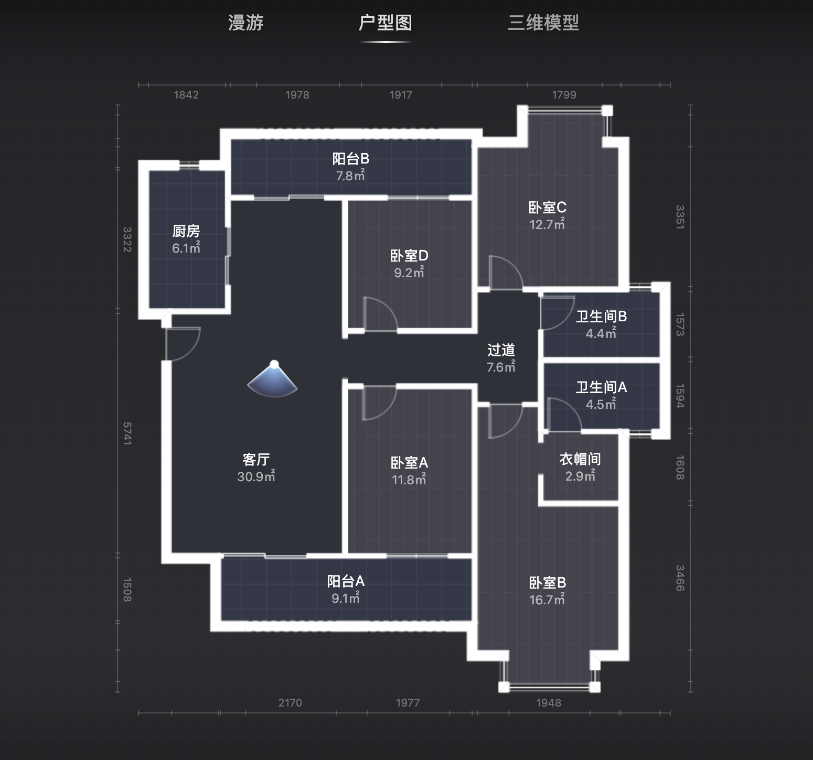

# 沙湖九号 · 房产核心空间档案

> 本文档基于贝壳找房与如视（Realsee）VR 平台实勘数据整理，作为视频制作、脚本编写、运镜路径规划以及多智能体协作的核心事实基础。

---

## 1. 房产基本信息

| 字段 | 标称数值 / 状态 | 来源与备注 |
|---|---|---|
| **项目名称** | 武汉·沙湖九号 | 贝壳找房房源页面标题 |
| **所在区域** | 湖北省武汉市武昌区沙湖板块 | 城市核心湖景与高档住宅聚集区 |
| **户型格局** | 4室2厅2卫2阳台1衣帽间 | 见实勘户型图标注 |
| **建筑面积** | 约 163.0 ㎡ | 贝壳找房 / 如视 VR 页面标称数据 |
| **套内标称面积和** | 123.7 ㎡ | 户型图中各空间标称面积累加值 |
| **房屋朝向** | 整体朝南（指北针显示北偏东约 30°） | 客厅、阳台A、卧室A、卧室B均享大面宽南向采光 |
| **楼栋空间特征** | 高层大平层，四开间朝南，南北双阳台对流 | 动静分区明确，通透性与私密性俱佳 |
| **VR漫游在线地址** | [如视VR漫游链接](https://open.realsee.com/ke/rXel3aPEWkwD4JQn/qrz3DGWoeBMCwu3h2TOlxEYTR8Q0Xy65/#lianjia) | 贝壳找房实勘全景与三维点云模型 |

---

## 2. 空间布局与各功能区详细数据

### 2.1 户型总览图示

*(原始全屏截图归档于 `05_资产库/01_户型图/floorplan_source.png`)*

### 2.2 三维模型与空间透视

*(原始三维建模截图归档于 `05_资产库/02_三维建模/3d_model_source.png`)*

---

### 2.3 各功能空间明细表

| 空间代码 | 空间名称 | 标称面积 (㎡) | 采光朝向 | 开间/进深标注参考 (mm) | 功能定位与空间特征 |
|---|---|---|---|---|---|
| `living_room` | **客厅** | 30.9 | 南偏西 | 纵向进深 5741mm，横向开间约 4000+mm | 核心会客活动区，客餐厅一体化，直通南向大阳台，南向巨幕采光 |
| `balcony_a` | **阳台A** | 9.1 | 正南向 | 纵向进深 1508mm，横向面宽约 6000mm | 景观休闲大阳台，无遮挡视野，日照充足，俯瞰城市与园林 |
| `kitchen` | **厨房** | 6.1 | 西向/北向 | 进深 3322mm，开间 1842mm | L/U型动线，与餐厅紧密衔接，操作高效 |
| `hallway` | **过道** | 7.6 | 户型中央 | 贯穿全屋静区枢纽 | 动静分区的关键通道，保证主客互不干扰 |
| `bedroom_a` | **卧室A** | 11.8 | 正南向 | 横向开间约 1977mm | 南向次卧，采光充足，适合作父母房或儿童房 |
| `bedroom_b` | **卧室B（主卧）** | 16.7 | 南向/东向 | 纵向进深 3466mm，横向开间 1948mm | **豪华主卧套房**，带独立衣帽间（2.9㎡）与独立主卫（4.5㎡），套房面积达 24.1㎡ |
| `walk_in_closet`| **衣帽间** | 2.9 | 套内过渡 | 纵向进深 1608mm | 主卧套房内部步入式衣帽收纳空间，豪华尊贵 |
| `bathroom_a` | **卫生间A（主卫）** | 4.5 | 东向 | 纵向进深 1594mm | 主卧私享卫生间，带采光通风窗，干湿分离 |
| `bathroom_b` | **卫生间B（公卫）** | 4.4 | 东向 | 纵向进深 1573mm | 公共卫生间，干湿分离设计，服务次卧及客区 |
| `bedroom_c` | **卧室C** | 12.7 | 东北向 | 纵向进深 3351mm，横向开间 1799mm | 东北角静谧次卧，大窗采光，方正实用 |
| `bedroom_d` | **卧室D** | 9.2 | 正北向 | 横向开间 1978mm | 多功能书房/客房，直通北向阳台B |
| `balcony_b` | **阳台B** | 7.8 | 正北向 | 横向面宽 1978mm | 北向生活家政阳台，与南向阳台A形成绝佳南北对流穿堂风 |
| **合计** | **套内使用面积** | **123.7 ㎡** | - | - | **得房率约 76%（以建面163㎡计）** |

---

## 3. 房产核心卖点与宣推亮点（用于视频脚本）

参考标杆视频（`05_资产库/04_参考视频/reference_video.mp4`，世茂锦绣长江江景房短片）的设计逻辑：“**先让人记住卖点，再用视觉反复补证，中段代入布置想象，末尾引导动作**”：

1. **核心区位与圈层定位（定题锚点）**：
   - 武汉武昌核心沙湖大平层，建面约163㎡ 奢阔四房。
2. **采光与通透王牌（前段视觉暴击）**：
   - 客厅 31㎡ 超大开间 + 9.1㎡ 巨幕南向观景阳台，采光视野开阔明朗。
   - 南北双阳台设计（南9.1㎡ + 北7.8㎡），真正的南北空气通透对流。
3. **空间尺度与生活代入（中段互动设问）**：
   - “这样一个 31 平的大横厅，你会怎么布置沙发和投影？”
   - 动静明确分区，北向多功能书房既可静心办公，又能连接生活阳台。
4. **豪宅专属私密感（后段品质证明）**：
   - 24㎡ 奢华主卧套房：卧室（16.7㎡）+ 独立步入式衣帽间（2.9㎡）+ 私享采光主卫（4.5㎡），双向采光，三代同堂互不干扰。
5. **行动号召（结尾CTA）**：
   - 评论区留“沙湖九号”，获取全屋三维漫游与高清户型解析。

---

## 4. 机器与数据一致性声明
- 本文档数据由 `02_架构与合同/02_房产数据合同.json` 同步生成；
- 所有尺寸、面积取自如视平台标注，非不动产权证官方最终测绘数据，实际以产权登记为准；
- 在视频中涉及数字时，可自然表述为“约163平米”、“31平大客厅”、“9平多大阳台”、“24平独立主卧套房”。
