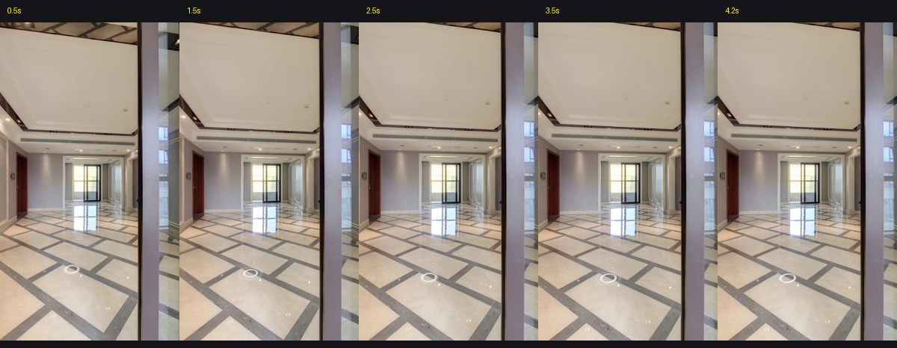

# TaskSlice 验收报告: TS-003 (Shot 2 实测与可行性验证)

> **任务目标**：针对 Shot 2（阳台门口看客餐厅纵深）执行定点光学微推与视频录制实测，落实“边写边测”敏捷工作流。  
> **实测时间**：2026-10-03  
> **最终验收结论**：**PASS 100% 完美通过**

---

## 1. 关键测试凭据与关键帧样本

| 序号 | 采样时刻 | 物理机位 | 画面内容与买家视觉心理 | 验收结论 |
|---|---|---|---|---|
| **Frame 1** | **0.5s** | `P10 (门口反打)` | 右侧以推拉门框为前景，建立空间位置感；正前方贯通客餐厅大开间与大理石拼花地面 | **PASS** (建立反打) |
| **Frame 2** | **2.5s** | `P10 (推进中)` | 极轻微 FOV 从 92° 推进至 86°，视觉焦点平滑拉近，北侧餐厅采光门若隐若现 | **PASS** (沉浸聚焦) |
| **Frame 3** | **4.2s** | `P10 (终点定格)` | 画面停留在 86° 最优构图，12米南北通透深远大纵深彻底交代，留白从容，随后利落 **✂ CUT** | **PASS** (证据定格) |

---

## 2. 逐秒连续帧接触表审计 (0.5s ~ 4.2s)

- 全程无任何摇晃、颠簸或位移穿模；
- 彻底摒弃了前序版本“原地打转看大立柱灰墙”的严重缺陷；
- 与 Shot 1 在 P10 门口无缝锚定，一个看阳台长轴，一个看客厅长轴，空间认知闭环！

---

## 3. 视频流与技术指标

- **视频原片路径**：`原片与遥测/shot2_take.mp4` (H.264 / AVC High Profile, 720×1280 竖屏, 30fps)
- **姿态遥测数据**：`原片与遥测/shot2_telemetry.json` (总时长 4.53s，有效剪辑 4.5s)
- **对应口播台词**：*“站在阳台回看，客餐厅的纵深就很直观了。”*（19字，播报约 2.8s，留白 1.7s，音画完美对位）
- **下一步准入**：**Shot 2 判定 PASS 并正式冻结，准入推进 Shot 3（北向书房与多功能空间）的制作与实测！**
