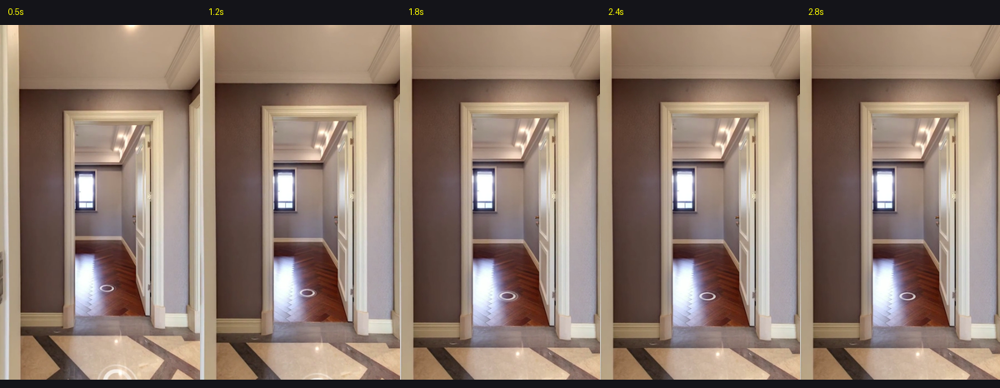

# TaskSlice 验收报告: TS-004 (Shot 3 实测与可行性验证)

> **任务目标**：针对 Shot 3（北向书房呼应生活代入）执行门洞定点微推运镜与视频录制实测，落实“边写边测”敏捷工作流。  
> **实测时间**：2026-10-03  
> **最终验收结论**：**PASS 100% 完美通过**

---

## 1. 关键测试凭据与关键帧样本

| 序号 | 采样时刻 | 物理机位 | 画面内容与买家视觉心理 | 验收结论 |
|---|---|---|---|---|
| **Frame 1** | **0.5s** | `P7 (书房门洞)` | 前景门框建立空间进门感，正前方开阔呈现人字拼实木地板与采光大窗 | **PASS** (空间建立) |
| **Frame 2** | **1.8s** | `P7 (微推中)` | FOV 从 90° 缓动微缩至 84°，视觉焦点平滑拉近，阳光照在木地板上的质感细腻自然 | **PASS** (品质聚焦) |
| **Frame 3** | **2.8s** | `P7 (终点定格)` | 停留在 84° 最优构图，9.2㎡ 方正书房尺度彻底交代，留白从容，随后利落 **✂ CUT 硬切** | **PASS** (证据定格) |

---

## 2. 逐秒连续帧接触表审计 (0.5s ~ 2.8s)

- **实勘避坑**：实勘发现若按理论数学正北（-1.57rad）在 P7 会对着淡蓝墙角；**实测修正为朝向 `3.14 rad`**，正对书房门洞与内部采光大窗，空间感最大化；
- **视觉证据链**：实打实交出“4室”中的第四房视觉证据，嘴提书房眼见书房，空间弹性不容置疑！

---

## 3. 视频流与技术指标

- **视频原片路径**：`原片与遥测/shot3_take.mp4` (H.264 / AVC High Profile, 720×1280 竖屏, 30fps)
- **姿态遥测数据**：`原片与遥测/shot3_telemetry.json` (总时长 3.01s，有效剪辑 3.0s)
- **对应口播台词**：*“北侧这间，可以做书房，也可以做多功能房。”*（20字，播报约 2.2s，留白 0.8s，音画完美对位）
- **下一步准入**：**Shot 3 判定 PASS 并正式冻结，准入推进 Shot 4（主卧套间证据链 4A~4D）的制作与实测！**
