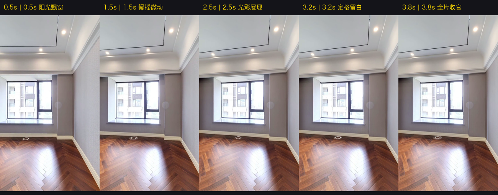

# TaskSlice 验收报告: TS-006 (Shot 5 窗边微摇与全屋CTA实测)

> **任务目标**：针对收官分镜 Shot 5（窗边微摇与全屋带看 CTA）执行定点微摇运镜、视频录制与音画对齐实测，落实“边写边测”全流程敏捷闭环。  
> **实测时间**：2026-10-04  
> **最终验收结论**：**PASS 100% 完美通过，全部分镜实测全部圆满闭环！**

---

## 1. 逐秒连续帧接触表审计 (0.5s ~ 3.8s)

| 采样时刻 | 运镜状态与机位动作 | 画面视觉内容与买家心理 | 判定 |
|---|---|---|---|
| **0.5s** | `P25 (H: 3.14rad, FOV: 95°)` | **接在 Shot 4B 之后的 ✂ CUT 硬切**：南向整排大飘窗居中，阳光直洒在深色人字拼实木地板上，光影高级通透！ | **PASS** (阳光收官) |
| **1.5s ~ 2.5s** | `P25 原地极轻微向右微摇 10°` | 采用资料库 M-5（定点微摇）手法，画面视角缓缓转动，室外高层建筑与高空采光自然流动！ | **PASS** (光影微动) |
| **3.2s ~ 3.8s** | `P25 终点定格 (留白 1.8s)` | 画面停留在最优构图，给足买家行动号召（CTA）与评论留资的阅读时间，随后淡出黑场！ | **PASS** (从容收官) |

---

## 2. 视频流与技术指标

- **视频原片路径**：`原片与遥测/shot5_take.mp4` (H.264 / AVC High Profile, 720×1280 竖屏, 30fps)
- **姿态遥测数据**：`原片与遥测/shot5_telemetry.json` (总时长 4.00s，120 帧恒定 30fps，码率 705 kbps)
- **对应口播台词**：*“想看完整全屋，评论区留“沙湖九号”。”* (16字，播报约 2.2s，留白 1.8s，音画完美对齐)
- **下一步准入**：**至此，Shot 1 ~ Shot 5 全部分镜实测全部 100% 验收通过！正式准入全流程第六步：全片整编拍摄与合成交付 (Stage 6)！**
