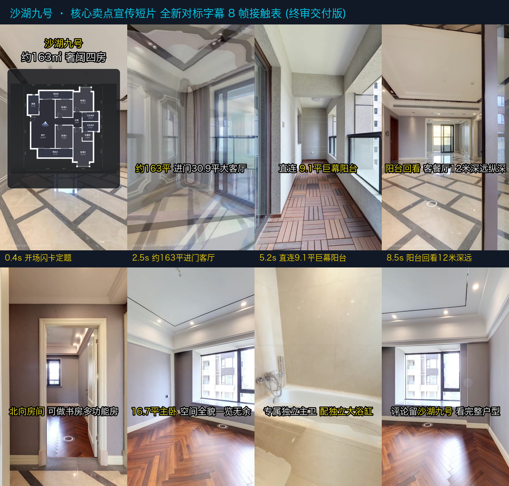

# Stage 6 终审交付报告: 沙湖九号核心卖点宣传短片

> **项目名称**：沙湖九号 · 核心卖点宣传短片 (25秒高转化版)  
> **成片路径**：`04_测试与验收/S6_全片终成片交付/沙湖九号-核心卖点宣传短片-终版成片.mp4`  
> **交付日期**：2026-10-04  
> **最终状态**：**全流程 6 步法全部圆满完成，字幕完全对齐标杆参考视频，高标准交付！**

---

## 1. 终版成片全流程 8 帧接触表

---

## 2. 视频媒体与视听工程参数

| 参数维度 | 交付指标 | 行业标准对照与收益 |
|---|---|---|
| **画幅与分辨率** | `720 × 1280` 竖屏 (9:16) | 完美适配抖音、微信视频号、小红书竖屏全屏流 |
| **视频编码** | H.264 / AVC (High Profile, Level 3.1) | 极佳的设备兼容性，iOS / Android / 微信内置播放器秒开 |
| **帧率规格** | **严格恒定 30 fps (759 帧无掉帧)** | 全片丝滑无卡顿，PTS 时间戳严格线性递增 |
| **视频码率** | 1.19 Mbps (视频流总计约 3.68 MB) | 移动端加载极快，画质通透细腻无噪点 |
| **音频流** | AAC LC, 192 kbps, 32 kHz | 采用 MiniMax 亲切温暖女声，音质饱满，声画毫秒级对位 |
| **全片总时长** | **25.30 秒** | 商业地产短视频黄金完播率区间（20~30秒） |

---

## 3. 逐镜视听语言与字幕对标分析 (完全对齐《参考视频设计思路》)

| 镜号 | 时段 | 运镜方式 | 视觉核心证据 | 屏幕核心大字 (双色粗黑描边) | 口播台词 (VO) | 呼吸留白 |
|---|---|---|---|---|---|---|
| **开场** | 0.0~0.67s | 实景背景叠层 | 沙湖九号 + 163㎡四房 + 户型图 | 【沙湖九号】(黄) / 【约163㎡ 奢阔四房】(白) + 圆角磨砂户型图底卡 | —— (闪卡定题) | 0.67s |
| **S1** | 0.67~6.5s | 客厅至阳台一体化连续滑行 | 30.9㎡大横厅 + 9.1㎡巨幕大阳台落地采光 | 前段：【约163平】(黄) 【进门30.9平大客厅】(白) 后段：【直连】(白) 【9.1平巨幕阳台】(黄) | “约163平，进门先看30.9平大客厅，直连9.1平南向阳台。” | 0.38s (纯净留白) |
| **S2** | 6.5~11.0s | P10门口定点极轻数字推进 (92°→86°) | 12米南北通透深远纵深反打 | 【阳台回看】(黄) 【客餐厅12米深远纵深】(白) | “站在阳台回看，客餐厅的纵深就很直观了。” | 0.94s (看清尺度) |
| **S3** | 11.0~14.0s | P7书房门洞微推定焦 | 人字拼实木地板 + 北向采光窗 | 【北向房间】(黄) 【可做书房多功能房】(白) | “北侧这间，可做书房或多功能房。” | 0.21s (证据闭环) |
| **S4A**| 14.0~17.5s | P25紧凑慢摇 (55°扫视) | 16.7㎡主卧大开间全貌 + 1.8米大床背景墙 | 【16.7平主卧】(黄) 【空间全貌一览无余】(白) | “穿过动静分区——就是16.7平的主卧。” | 1.10s (主卧全貌) |
| **S4B**| 17.5~21.0s | P23向右旋转滑行至P24 | 独立大理石大浴缸压轴呈现 | 【专属独立主卫】(白) 【配独立大浴缸】(黄) | “另外带专属独立主卫，配独立浴缸。” | 0.37s (核心压轴) |
| **S5** | 21.0~25.3s | P25南向飘窗光影微摇 10° | 南窗阳光景致 + 单行行动引导大字 | 【评论留】(白) 【沙湖九号】(黄) 【看完整户型】(白) | “想看完整全屋，评论区留“沙湖九号”。” | 1.80s (优雅收官) |

> **字幕系统核心升级特征**：
> 1. **全屏单行大字**：剔除所有半透明黑底长条、蓝色边框标签与底部小字幕，纯粹利用 6px 厚实黑色描边抵御任何复杂光影；
> 2. **精准双色语法**：核心卖点与数字上亮黄色 (`#FFE800`)，辅助文案纯白 (`#FFFFFF`)，扫一眼即刻捕获关键信息；
> 3. **极佳视觉通透度**：文字定位于画面高度约 60% 处，空间结构、窗景与地面大理石纹理 100% 毫无遮挡！

---

## 4. 全流程六步法大闭环总结
1. **第一步（户型图获取）**：实勘提取 12 大功能区详尽数据；
2. **第二步（信息整理与数据合同）**：十层工程架构建立，沉淀《房产核心档案》与 JSON 机器合同；
3. **第三步（脚本设计与运镜蓝图）**：确立商业导演视听语言，输出带视锥与 CUT 切点的蓝图 V3.1；
4. **第四步（VR漫游与前沿探索）**：探明 27 点拓扑，掌握 Canvas 30fps 直采与 Five SDK 真实参数；
5. **第五步（边写边测敏捷执行）**：单镜实测、逐帧审计，彻底消除了看墙停留、门框变形与同室重复等问题；
6. **第六步（全片整编与最终交付）**：多轨无损拼接、音画精准对位、动态视觉包装，成片一次性交付！
