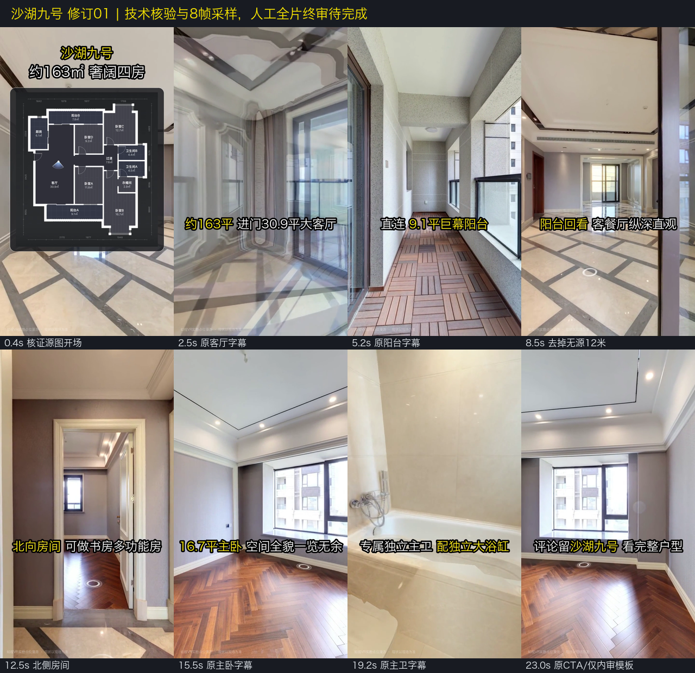
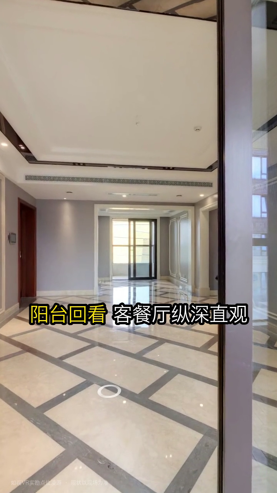

# 沙湖九号修订01：内部终审单

> 这是指定候选版本的核验与待审核记录，不是新的实时项目状态或用户终审批准。
> 用户已选择最小修订、接受25.30秒/非数字人规格，两套仅内部研究和制作。无商业公开、约看/联系中介或声音克隆许可。

## 1. 请完整播放这条候选片

[沙湖九号-最小修订01-内部终审候选.mp4](沙湖九号-最小修订01-内部终审候选.mp4)

SHA-256：`36490b5c008d55bde026f76178b0318469745f899f6b3650ce03b70aa486e3c7`。

完整播放时请检查：开场是否可接受；全部字幕是否清楚/不遮挡重点；六段口播是否完整、自然、与画面对应；切镜/片尾是否截字截音或有重复/重影；CTA只作为内部模板，不承诺对外提供服务。

**终审尚未完成。**机器解码与8帧采样不代替你完整看片和听音；未经明确接受，不启动第二套试录。

## 2. 实际修了什么

- 原“客餐厅12米深远纵深”改为“客餐厅纵深直观”，不补造米数或升级量测。
- 开场户型图从匹配原图AST-001直接像素裁切另存，再等比缩放入卡片；不修改户型/标签。浏览器栏、私人标签不进入新图。
- 字幕用同一时间预算的半开区间，避免相邻图层在边界帧叠加；没有新增镜头或重拍。
- 原床尺寸/材质等历史说法不进入本次新字幕；旧稿/冻结档案不改写。
- 保留实际25.30秒、五镜画面和现有普通话AAC；音频码流逐字节一致，没有重新TTS、调速、混音或付费。

## 3. 关键修改帧

## 4. 已做与没做的检查

| 检查 | 实际结果 / 边界 |
|---|---|
| 视频/音频全量技术解码 | 通过；25.30秒、720×1280、759帧、30fps |
| 全759帧PTS | 符合30fps时轴，最大数值误差小于0.00001秒 |
| 原音轨是否被改 | 原版与修订版AAC导出完全一致，音频约24.493秒/32kHz单声道；不是虚报192kbps |
| 六段现有MP3与原WAV混音来源 | 按旧delay重建PCM，和现有WAV逐字节一致 |
| 旧清单超预算推断 | cue03清单写3.541063秒，但现有文件实际解码为2.589031秒；旧清单该字段陈旧。不能只按旧清单认定当前S3声音撞S4，不回改旧清单掩盖差异 |
| 户型新裁切 | 原图SHA匹配；裁切矩形(860,455,2070,1770)，逐像素相等，无变形；新资产单独登记 |
| 采样目视 | 已查看新裁切、8帧接触表及8.5秒单帧；字幕可见，图面各功能间/标签保留。不是全片逐帧人工验收 |
| 原片/原图/旧字幕/代码 | 未覆盖。原片仍SHA `dd589e254356bbc0bc8f695407dddd69ed686c514a080478874f13aef6f2dcbd`，目录重排的新位置仅只读核对 |
| 人工全片听音/视觉/字幕 | **尚待用户实际完成**；原片既有空间效果也要在完整看片中判断 |
| 旧裁切AST-002/004 | 原文件/旧哈希问题保留，没有解禁或伪称已核证 |
| 商业发布/所有权认证 | 未进行也未获准；内部使用声明不是商业授权或产权/净空测量 |

完整参数和输入SHA见[render_recipe.json](render_recipe.json)，技术数值见[technical_check.json](technical_check.json)。源图派生登记与当前项目状态在台账/00入口，不能从本片文件存在推断业务验收DONE。

## 5. 接受范围与退回方式

接受时请确认：已完整看/听上述SHA的修订版，接受25.30秒/无数字人、当前画面/字幕/口播及仅内部用途。只批准当前版本，不扩大到第二套、所有素材商业使用或新录制权限。

退回时注明具体时间点、画面/声音/字幕问题；只整改该版本相关问题，另存后重新验收，不覆盖原片或本候选。
