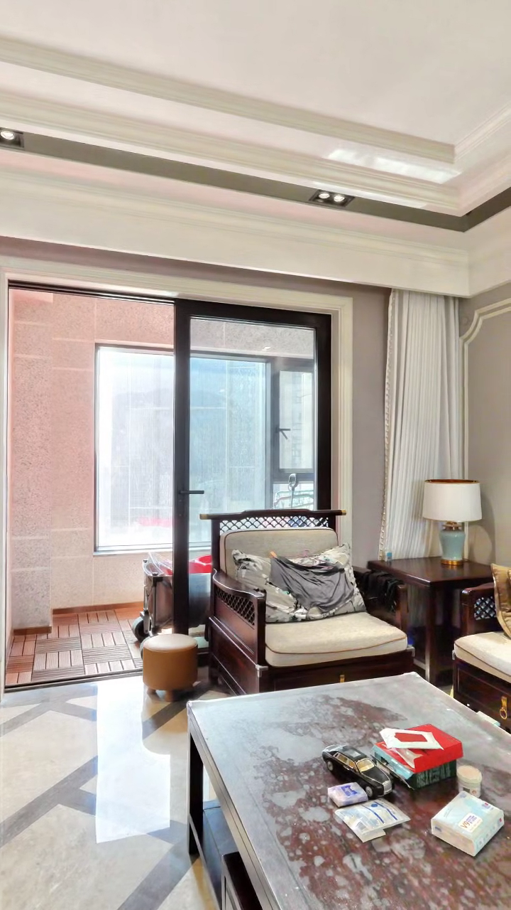

# 第二套 S1 · 原生定点静默试验01审看入口

> 2026-10-05事件记录。仅用户已批准的1号客厅点、6秒静默定点转向；不是30–45秒终片，不是当日现场实拍或真人连续带看。实时阶段只看[00_当前](../../../../00_入口/00_当前.md)。**试验已停在本镜，未设计/制作第二镜，待用户完整审看。**

## 播放本次唯一版本

[打开6秒MP4](武汉104119325592-S1-原生定点静默试验01.mp4)

- SHA-256：`d44acd7598cb675c80eaec3102f96eac5b0d152c5ebd9198cfd82974b2fe8fdf`
- 720×1280，30fps，180帧，6.000秒，H.264，无音轨、字幕、数字人、CTA或新增付费。
- 来源：同套原包`faces/1-front.avif`，真实2048²/90°立方体面；本地Pillow透视重投影＋FFmpeg编解码，不生成房间/对象、不跨点、不改变采集位置。
- 动作：源front面相对yaw −8°→+8°，余弦缓入缓出，pitch/roll=0；不是全局SDK方位，更不是推进或走入阳台。
- [独立第二套当前镜事实合同](../../../../02_架构与合同/第二房源_104119325592/01_房产核心档案.md)、[本次许可/动作/成本/输出合同](../../../../02_架构与合同/第二房源_104119325592/02_当前镜试验合同_01.json)、[逐帧姿态与配方](render_recipe.json)。

## 已做的检查及边界

1. [14项只读守卫/投影数学测试](../../准入核证01_20261005/首镜预检与守卫测试.json)：错房/错点/缺原生例外/位移/超时/声音/CTA/付费/生成/越权指标拒绝；每帧射线都在原始面有效像素内，源/合同/证据哈希一致。
2. [编码技术检查](technical_check.json)：180帧全解码、6秒/30fps/CFR PTS通过，无音轨；原始面前后SHA一致。
3. [防重跑检查](rerun_guard_check.json)：重复执行在预检即拒绝，既有试验文件完全不变，没有第二次编码；不是实际试片失败。
4. [浏览器实播](browser_playback.json)：完整播放至6秒、约6002ms、无媒体错误，受控播放新增丢帧为0；149次视频回调不等于180帧逐帧人工审。原生浏览器播放MP4不证明桌面Computer Use或SDK漫游通过。
5. [有限视觉检查](review.json)：已查看六张接触表中全部180个144×256缩略帧，另看0/107/179帧720×1280图及浏览器终帧。可见真实阳台门口、椅子、茶几；在该范围未见黑边缺面、跨点重影或跳切。未冒称全部帧全分辨率人工终审。

**构图需要你判断**：近景茶几和原有杂物占比大，沙发全景不完整；这证明当前定点转向可实现，不自动说明适合作为“客厅开阔感”首镜。没有为营销效果清空/替换家具。

## 不被本次通过的项目

- 用户为本点本次批准原生视角例外；眼高坐标差约1.226不是物理测量。没有真人1.5–1.6m或0.5m净空认证，不升高/伪移全景。
- 本次只依赖已视觉核对的pano1。原生room ID、卧室A/B/C/D与面积标签精确对应、第三阳台独立画面仍缺，不解禁全屋room-ID执行。
- 500万/在售是本次官方工具来源声明，数据更新时间缺失；不保证实时价格、可售或现场房况，本镜不展示这些字段。来源VR是3月资料。
- 用途仅内部；不是商业发布或平台素材权利认证。第二套普通话匿名声音是整体brief方向，本次没有TTS或声线许可外推。

## 用户审核与下一步

请完整观看上述6秒，判断**构图/主体、转向速度、真实感与是否作为当前镜保留**。尚未收到这个SHA的接受。

- 接受后，才能另提出下一镜的当前脚本/点位及许可；不能自动录下一镜或整片。
- 不接受则只讨论本镜改动与新的take许可，保留take01，不覆盖、不跳过。
- 不从机器/助手有限检查推导用户批准。最终30–45秒/声音/字幕/CTA与全片人审尚未完成。
