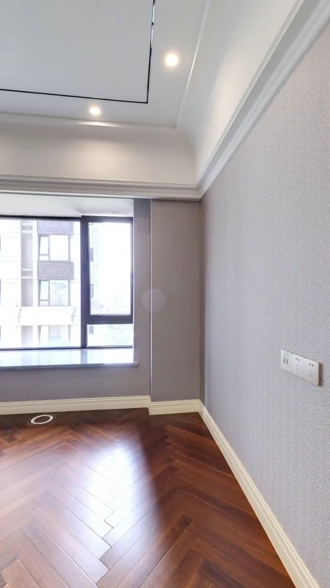
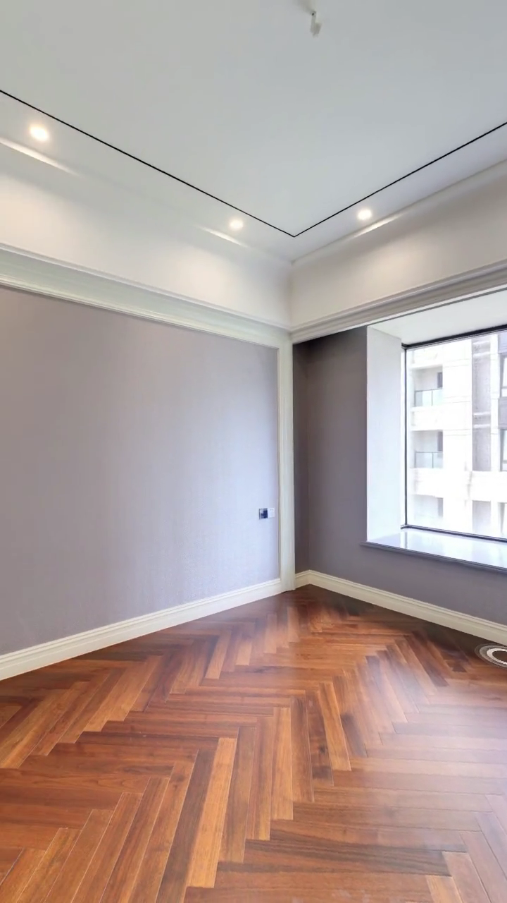
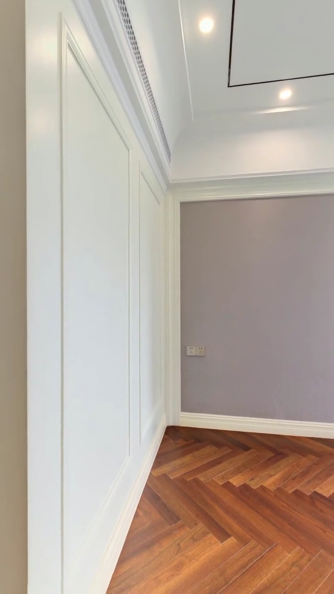

# 模式 01：采光向心全景横扫法 (Daylight-to-Core Panorama Sweep)

> **模式代号**：`M-SWEEP-BEDROOM`  
> **核心法则**：**从采光高潮（落地大窗/大飘窗）起步，平滑横扫空间腹地，定格核心家具位（大床背景墙）**。

---

## 1. 动态演示与关键帧图解

### 演示视频
- [点击播放演示视频 (MP4)](视频/演示视频_主卧大开间全貌横扫.mp4)（720×1280 竖屏，时长 3.5s，恒定 30fps）

### 关键过程分解截图

| 步骤 1: 左侧起步 (大采光窗景) | 步骤 2: 中段横扫 (开间与实木地板) | 步骤 3: 终点定格 (大双人床背景墙) |
|---|---|---|
|  |  |  |
| **0.5s**：整扇南向大落地窗与大理石飘窗台，阳光洒满深色人字拼实木地板！ | **1.8s**：平滑向右横扫过整间 16.7㎡ 主卧横向深远的大空间格局与吊顶出风口！ | **3.0s**：扫至整面大床背景墙与双控开关面板，交代大床位置与宽绰余量！ |

---

## 2. 适用场景与买家认知价值
- **适用空间**：主卧、大次卧、独立书房（面积 $\ge 9.0 \text{ ㎡}$ 的方正大居室）；
- **解决的买家痛点**：
  - 彻底终结“缩在门口看门缝/墙角”的小气视角；
  - 一镜之内连续交代三大买家核心关切：**自然采光窗景 $\rightarrow$ 空间开间与地板质感 $\rightarrow$ 2米大双人床摆放位置与两侧宽绰余量**，空间感极具排面！

---

## 3. 标准机位六元组参数模板 (沙湖九号实证)
- **机位位置**：居室中央或靠窗侧开阔点位（沙湖九号主卧 `P25`，距门口 1.7m，距窗边 2.6m）；
- **起点朝向**：左侧整扇南向大落地窗与大理石飘窗台（`H: 2.90 rad`）；
- **横扫动作**：平滑向右匀速慢摇（角速度约 $0.6 \text{ rad/s}$，耗时 $3.5 \text{ s}$）；
- **终点朝向**：精准停留在床头精装背景墙与双控开关面板中央（`H: 5.00 rad`）；
- **留白要求**：终点必须保持静止留白 $1.5 \sim 2.0 \text{ s}$，让买家看懂大床余量与空间排面；
- **标准视场角**：`FOV: 90° ~ 95°`。
