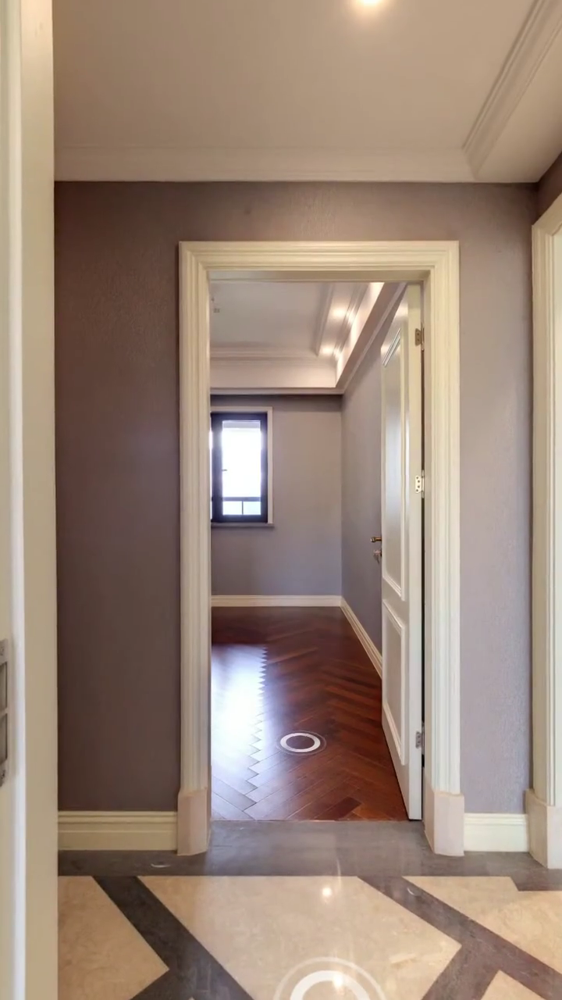
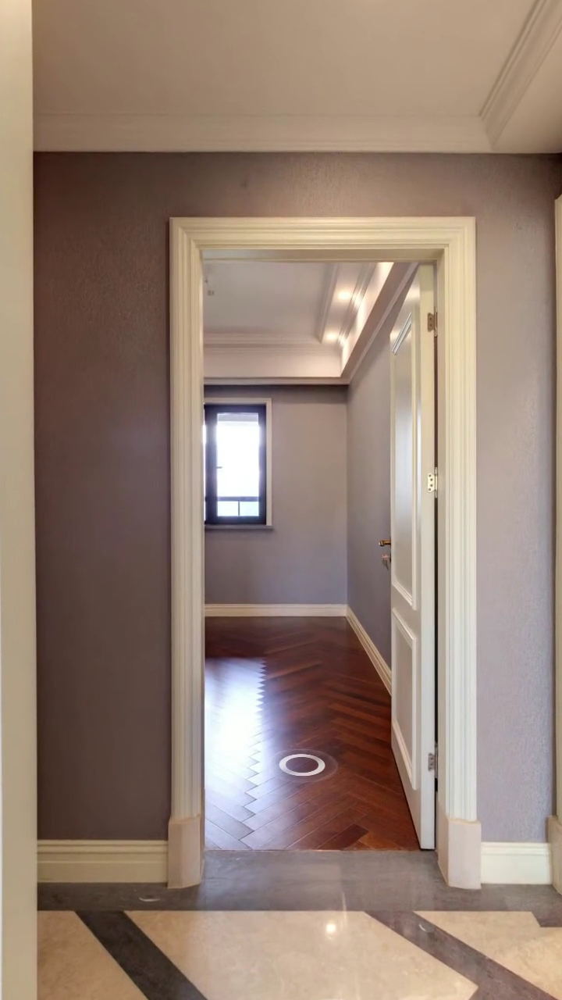
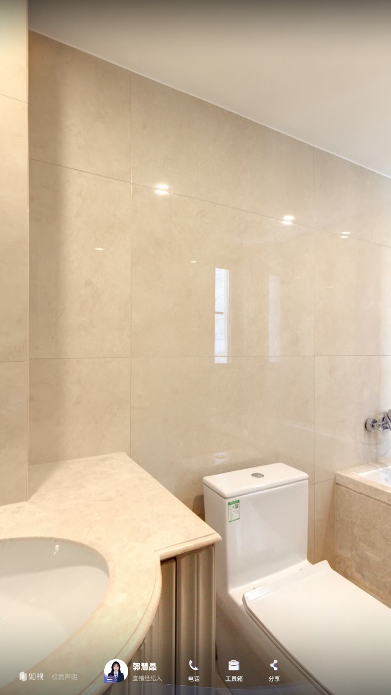

# 模式 02：狭小空间轴线微推定焦法 (Narrow Space Axial Dolly-In)

> **模式代号**：`M-AXIAL-DOLLY-IN`  
> **核心法则**：**站在门外正中，正对进深轴线，绝不左右摆头，仅执行极轻微平滑向前微推**。

---

## 1. 动态演示与正反对比图解

### 演示视频
- [点击播放演示视频 (MP4)](视频/演示视频_狭小空间轴线微推.mp4)（720×1280 竖屏，时长 3.0s，恒定 30fps）

### 正反案例对比截图

| 推荐做法: 门框建立前景与轴线微推 | 推荐做法: 终点定焦洁具品质 | 避坑警示: 狭小空间近墙大扫视 |
|---|---|---|
|  |  |  |
| **0.5s 起步**：白色门框作为前景建立空间深度，视线笔直贯穿空间进深轴线 | **2.2s 微推定格**：FOV 从 90° 缓动缩至 84°，画面沉稳聚焦，质感高档 | **严重避坑**：机位离墙不足 1 米，大角度横扫导致墙砖飞掠眩晕、门框严重遮挡抢戏！ |

---

## 2. 为什么狭小空间（$< 5 \text{ ㎡}$）严禁大角度横扫？
1. **近距离飞掠眩晕**：小空间内镜头旋转时，近景墙面与瓷砖缝隙高速划过屏幕，产生强烈的视觉压迫与眩晕感；
2. **门套立柱严重遮挡**：在狭窄门口转动时，门套在画面中占据近半画幅，画面严重割裂破碎；
3. **边缘鱼眼拉伸畸变**：小空间内的洁具在转入画面边缘时会被广角透视严重变形拉扯。

---

## 3. 标准机位六元组参数模板
- **机位位置**：卫生间/小储藏室门外正中（门洞轴线延长线上，距门洞约 0.5m）；
- **朝向设定**：严格正对空间核心景观轴线（如正对洗手台/淋浴隔断，`Yaw` 保持静止）；
- **微推动作**：在 $2.0 \sim 2.5 \text{ s}$ 内平滑向前微位移 $0.3 \sim 0.5 \text{ m}$，或执行 `FOV: 90° → 84°` 数字微推；
- **留白要求**：终点保持静止留白 $1.0 \sim 1.5 \text{ s}$；
- **剪辑出点**：**✂ CUT 硬切**，干净利落。
