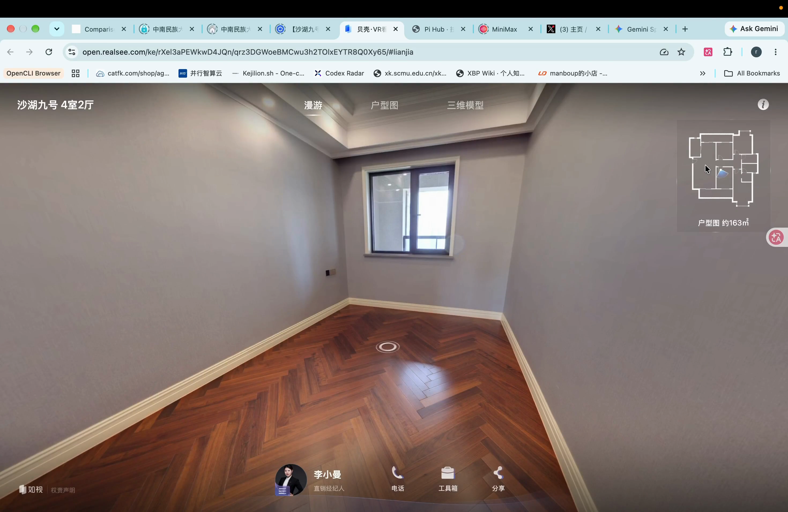
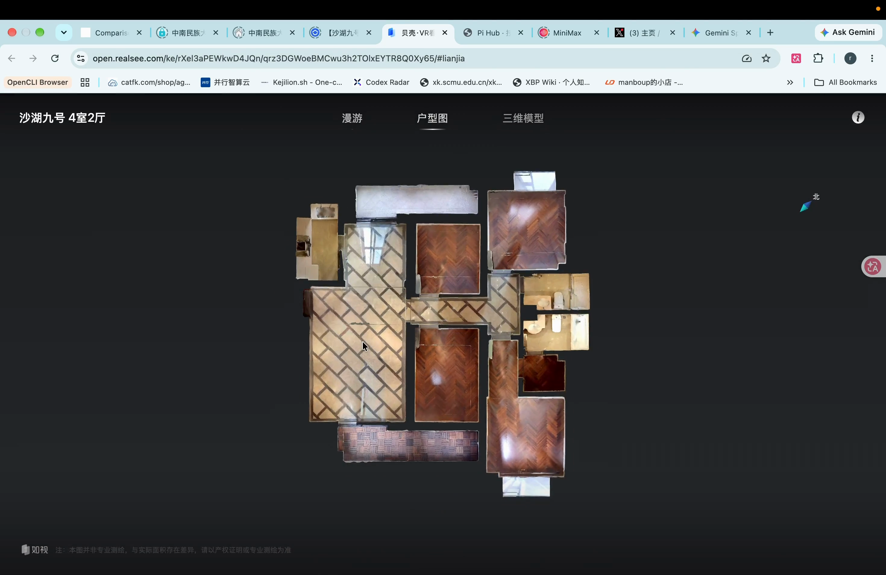
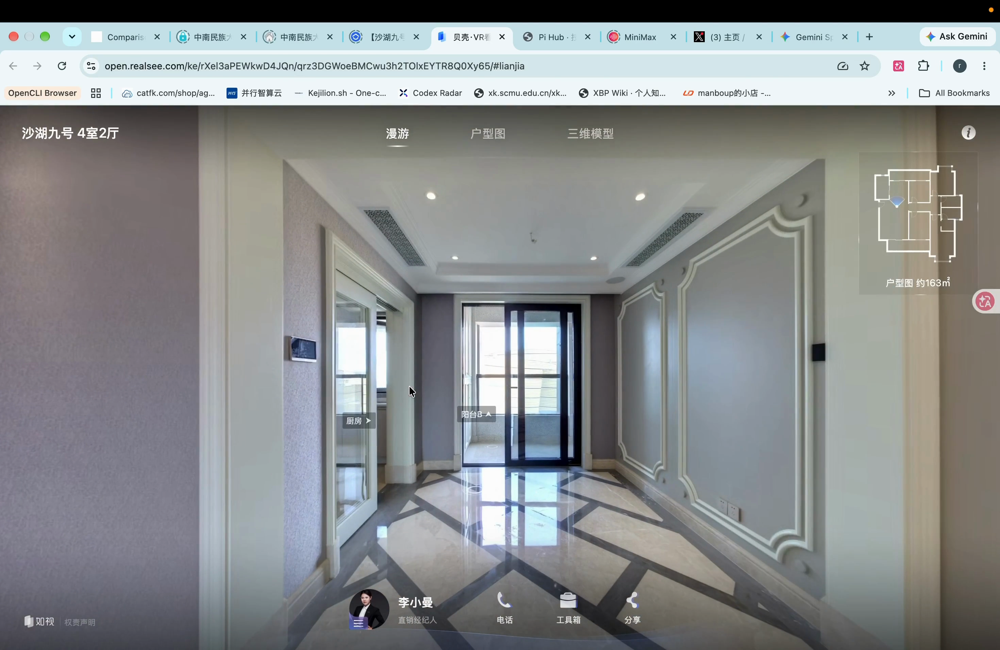

# 模式 03：三维破面穿梭法 (Dollhouse-to-Pano Plane-Breaking Transition)

> **模式代号**：`M-TRANSITION-BREAK-PLANE`  
> **资产归属**：整合自 `08-真人录制/素材库/转场视频/01-破面法/`  
> **核心法则**：**从宏观三维户型模型向下俯冲，“破开天花板”无缝穿入室内全景实景；或从室内全景高速拉升回到三维模型**。

---

## 1. 动态演示与过程图解

### 演示视频
- [点击播放演示视频 (MP4)](视频/演示视频_三维娃娃屋破面转场.mp4)（2940×1912 4K超高清，时长 3.5s，恒定 30fps）

### 穿透过程分解截图

| 步骤 1: 三维户型模型总览 | 步骤 2: 俯冲破开天花板 | 步骤 3: 落地室内实景 |
|---|---|---|
|  |  |  |
| **0.5s**：高空斜 45° 俯瞰整套沙湖九号三维娃娃屋模型，建立空间宏观感知 | **1.8s**：摄像机高速向下俯冲，“破开/穿透”客厅屋顶切片 | **3.0s**：平稳降落在客厅 P1 点位，无缝转化为 360° 纯净全景实景！ |

---

## 2. 商业短片应用场景与剪辑技巧
1. **片头定题穿梭 (Intro Hook)**：
   - 0~1 秒展示全屋三维模型（配字幕“沙湖九号 约163平”），随后“破面”俯冲直接接入 Shot 1 的客厅推向阳台，视觉奇观瞬间拉满完播率！
2. **片尾收官拉升 (Outro CTA)**：
   - 全屋讲解完毕后，镜头从主卧窗边向上破面穿透拉回三维模型，淡出叠加评论引导。
