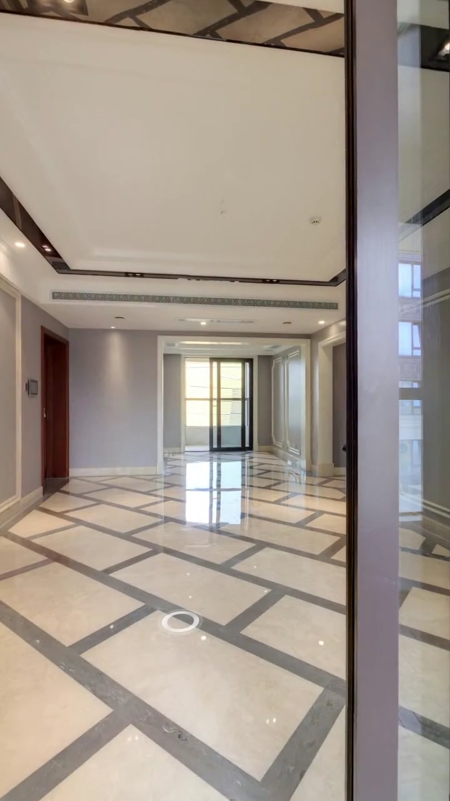
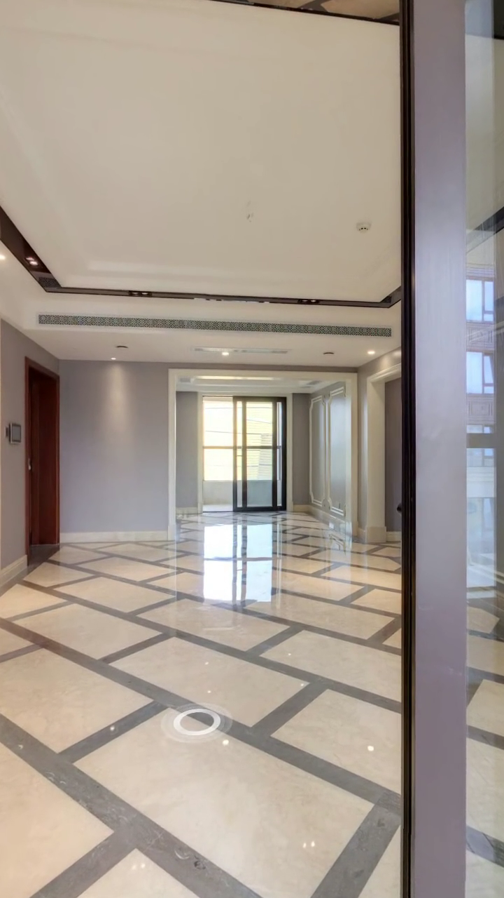
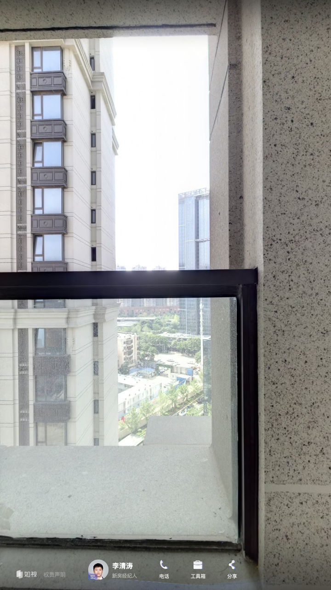

# 模式 04：反打长轴深远纵深透视法 (Deep Axial Counter-Shot)

> **模式代号**：`M-COUNTER-DEEP-AXIS`  
> **核心法则**：**站在空间连接门口（避开室内近身凸墙），沿房源最长通风/采光主轴线向内反打，展现大平层深远开阔度**。

---

## 1. 动态演示与正反对比图解

### 演示视频
- [点击播放演示视频 (MP4)](视频/演示视频_阳台门口反打客餐厅12米长轴.mp4)（720×1280 竖屏，时长 4.5s，恒定 30fps）

### 正反案例对比截图

| 推荐做法: 门口推拉门建立前景 | 推荐做法: 贯穿南北12米深远长轴 | 避坑警示: 空间尽头近墙死角 |
|---|---|---|
|  |  |  |
| **0.5s 起步**：右侧阳台推拉门门框作为前景，建立站在阳台门口看室内的空间基准 | **3.0s 透视定格**：视线笔直贯通客餐厅大开间，正对北侧餐厅推拉门采光，12米长轴一览无余 | **严重避坑**：若在阳台尽头 P11 原地回看，视线 70% 会被阳台厚重侧立柱遮挡，成为废镜头！ |

---

## 2. 为什么反打机位必须退至空间连接口？
1. **彻底避开视线盲区**：阳台、露台等外挑空间边缘通常有承重立柱或实体女儿墙，若在最远端原地掉头回望，镜头几乎必然被近墙糊脸；
2. **反向建立进深纵深**：在门洞入口处反打，门框自然形成电影级“框式构图（Framing）”，让买家清晰感知“从阳台到客厅、再到餐厅”的真实物理距离。

---

## 3. 标准机位六元组参数模板 (沙湖九号实证)
- **机位位置**：阳台门口 `P10`（空间交界处）；
- **朝向设定**：正对客餐厅长轴中心透视线（沙湖九号为 `H: 6.15 rad`）；
- **运镜动作**：定点 + 极轻微数字推镜（`FOV: 92° → 86°`，耗时 3.0s + 留白 1.5s）；
- **剪辑出点**：**✂ CUT 硬切**。
