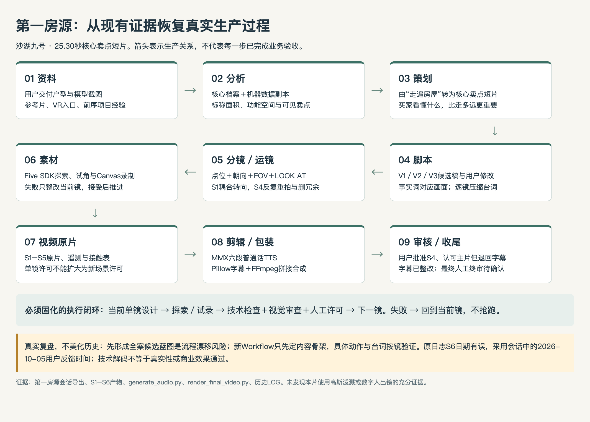

# 第一房源真实生产过程：沙湖九号

> 2026-10-05恢复版本。不是新的全套脚本或拍摄许可；不覆盖原片、旧稿、冻结合同及历史日志。
> 结论：**五镜与25.30秒成片已经存在，但“产物交付”和“真实性、字幕、音画及原规格最终验收”不是同一个完成条件。**用户本轮描述“接近完成”与会话中的有条件认可一致；收尾仍需人工裁决。

## 1. 从资料到成片实际怎么走

实际发生了全案候选蓝图V1–V3、逐镜试录、S1整改、S4多轮退回、S5、整片配音合成及字幕重做。不能将候选蓝图写成“所有镜头已测”，也不能声称历史全案预写已经严格满足“禁止写完再测试”。新流程保留内容骨架，具体台词/动作按镜闭环。

## 2. 证据优先级与时间线校正

- **P1 原始用户指令与审核**：[用户提供会话HTML](../../pi-session-2026-10-04T04-35-24-095Z_01a10531-fb3f-7537-a7d1-1aa11599652a.html)。本地解码JSON、沿leaf父链核对1861项、36条用户消息；不执行HTML脚本、不复制嵌入图片/推理内容/凭证、不公开该私有会话。
- **P2 实际文件、代码与测量**：[五镜证据导航](../../04_测试与验收/README.md)、[成片](../../04_测试与验收/S6_全片终成片交付/沙湖九号-核心卖点宣传短片-终版成片.mp4)、[音频清单](../../03_实现/audio/cues_manifest.json)、[合成代码](../../03_实现/render_final_video.py)、[前轮媒体核验](../../04_测试与验收/资料整理核验/素材与媒体盘点-20261005.json)。只能证明各自检查范围。
- **P3 过程记录与助手总结**：[LOG](../../07_运行记录/LOG.md)、旧交付报告。可作线索，不凌驾于用户原话或实际文件；“100%”“一次性交付”不是实测或人工验收证据。
- **房产事实**：本房源仍使用[冻结核心档案](../../02_架构与合同/01_房产核心档案.md)。平台标称、产权测绘、视觉观察与宣传推断必须区分；档案中的强宣传词不自动变成可发布事实。

| 本地时间（+08:00） | 原始用户entry ID | 真实生产事件与意义 |
|---|---|---|
| 10-03 15:45:08 | `d2e8c364` | 用户交付两图、参考片，规定六步法、边写边测及未来获取户型图skills目标 |
| 10-03 16:36:44 | `4387441a` | V2过于工程化，要求明确卖点短片定位、买家看懂什么、何时切镜 |
| 10-03 17:03:47 | `5a3ae28c` | V3进入试录前仍需压缩逐镜口播；全片平均语速不能保证每镜来得及说完 |
| 10-03 17:45:09 | `85402854` | S1位移/转向分离，出现看墙停留；后续改为耦合运动 |
| 10-03 21:55:35 | `fb5d6c2a` | S4只从门口看到小范围；用户明确禁止继续推进，直到审核通过 |
| 10-04 10:01:52 | `590be0bd` | 要求主卧左→右展示核心、卫浴不只直推；质疑重复卧室镜头 |
| 10-04 16:39:15 | `d87b627d` | 收紧主卧旋转，避免卫浴直面洗手台遮挡；提出“点位→核心→讲解→路线→拍摄”五步制度 |
| 10-04 17:06:07 | `96e924bb` | 仅卧室批准冻结；卫生间还要从左向右突出内部浴缸，部分批准不能扩大为整镜批准 |
| 10-04 17:56:02 | `e80786ad` | 原话“ok，shot4批准冻结，现在进入下一个阶段”；这是S4明确准入，旧LOG的17:55仅近似登记 |
| 10-05 09:12:48 | `e07b2700` | “最终版本可以通过。但是……字幕不行”，同时要求整理目录、最终产物不得放根目录；这是**有条件认可**，不是整改后最终终审 |

原日志把S6字幕/目录整改写在10-04 18:30，早于实际用户10-05 09:12反馈；旧S5/S6条目的日期也不能据此独立认证。保持原文，仅通过新增CORRECTION解释；后续按原始entry时间与对应产物判断。不在本导出中补造“字幕整改后用户再次全部批准”。

脱敏引用、原HTML哈希及考虑范围保存在[会话证据](../../04_测试与验收/流程升级核验/第一房源会话证据-20261005.json)。原HTML包含其他会话的继承历史，不等于父项目每一条记录均完整收录。

## 3. 用户要求的20项逐项恢复

| # / 事项 | 实际方法、产物与来源 | 成熟度 / 未证明内容 |
|---|---|---|
| 1 原始房源资料 | 用户手工交付户型/模型截图；AST-001/003原图、VR入口、AST-006参考片及前序项目只读经验，[源台账](../source_manifest.json) | 原图匹配；AST-002/004裁切图旧哈希不一致；未恢复完整获取网页轨迹 |
| 2 信息整理 | 核心MD＋JSON副本＋12功能区标签；后续Five SDK生成27点房间元数据 | 约163㎡建面、123.7㎡标称和；后者不是产权套内测绘或公摊认证；JSON不是第二事实源 |
| 3 卖点提取 | 参考片采用“主卖点反复视觉补证”；本房源选择客厅/南阳台、空间关系、北侧功能房、主卧/浴缸、CTA | 来自房产档案及可見画面；无传播数据/A-B测试，不称转化率最好；尺寸/材质不能凭推断补写 |
| 4 目标购房人群 | 大面积四房、家庭多功能空间和套房私密性支持“改善家庭”内容假设 | 未找到独立客户访谈/预算/成交画像；三代同堂等是适配建议，不是已验证购买群体 |
| 5 视频定位 | 用户要求由VR工程路径转为“核心卖点短片”，不假装完整全屋带看 | 定位有用户反馈；25.30秒不是原30–45秒全部要求已通过；没有60秒成片案例 |
| 6 视频脚本 | [历史V3.1](../../09_提案与草稿/02_导演蓝图与分镜台本_V3.md)及[归档](../../08_归档/ARCHIVE_INDEX.md)保留整案构思；逐镜修改后缩短S4 | 总览候选、冻结导演合同和最终片并不完全相同；具体新脚本必须逐镜验证 |
| 7 口播文案 | 当前6段普通话台词在音频清单：客厅/阳台→纵深→北房→主卧→主卫浴缸→评论CTA | 与旧蓝图、字幕存在文本差异；S3/S4A/S5语音超原预算，必须用实际时间轴复核 |
| 8 分镜设计 | S1客厅/阳台，S2反打，S3北房，S4主卧＋浴缸，S5窗边CTA；原片/接触表/报告对应 | 不是全屋12功能区均拍完；每镜证明一个主张优于凑全景 |
| 9 运镜设计 | SDK真实点位、yaw/pitch/FOV/时长；S1改位移转向耦合，S4紧凑横扫＋主卫右旋，删除同房冗余 | FOV不是dolly；点位/参数仅限本房源。1.5–1.6m真人标准不等于原生VR约1.17m；距离净空未量测 |
| 10 3D/Realsee/高斯空间 | 本片主要以在线Realsee/Five点位及Canvas实景录制；模型截图用于认识户型，方法C04有总览后硬切示范 | 不把娃娃屋示意当产权几何；未发现本终片依赖可重建的高斯泼溅模型/训练成果的充分证据；没有就不强行增加技术栈 |
| 11 真人/数字人 | 原需求列画中画/数字人；实际合成脚本没有真人或数字人图层，只有房屋、字幕和音轨 | 没有中介形象/身份授权、口型驱动或出镜验收；女声TTS不是数字人，也不证明真实中介身份 |
| 12 配音 | [generate_audio.py](../../03_实现/generate_audio.py)使用MMX `speech-2.8-hd`、`Chinese (Mandarin)_Warm_Bestie`，速度1.12–1.18；6个MP3留存 | 确有普通话TTS产物；当前未完整听音或核证声线商业许可；没有方言质量证据，成本账未完整保存 |
| 13 视频生成 | WebGL Canvas/SDK动作采集形成720×1280五镜MP4；非凭空生成室内画面 | 不同于图生视频或高斯空间重建；技术出片成功不等于无穿模/房间真实性完全认证 |
| 14 剪辑 | Python编写concat，FFmpeg拼接五镜；六段音轨按delay混合；Pillow制作PNG叠层；FFmpeg重新编码 | 不是Premiere/剪映工程；可恢复工程由脚本、素材清单、音轨与图层构成；固定路径和`-y`会覆盖，旧音轨存在则沿用 |
| 15 字幕/音乐/包装 | 原底栏/标签方案被用户退回；现在开场0.67秒户型闪卡，黄白单行描边卖点字、CTA、现状免责声明 | 当前代码未配置单独背景音乐轨，不能声称已有BGM流程；“12米”字幕无量测依据；卖点字不能替代无障碍完整口播字幕 |
| 16 最终审核 | 历史S4有人类冻结；方法库有机器门禁/视觉review；终片有ffprobe、解码、PTS及采样截图 | 前轮23测试/391哈希/34方法视频解码只认证各自范围；本次不重新运行或当全片人类听音、事实及权利通过 |
| 17 制作问题 | 看墙、门口窥视、卫浴焦点错误、同房重复、黑场/模型俯冲、透明遮挡、字幕不合参考、目录混乱、时间轴和日期漂移 | 问题要具体绑定take/反馈；宣传夸张、“100%”总结及旧状态不是证据 |
| 18 已解决问题 | 用户反馈推动S1重构、S4紧凑横扫/浴缸焦点/去冗余；S4获明确批准；字幕重新包装、终片已在S6目录 | 解决特定问题不证明所有帧安全、字幕事实全部正确或新房源可用；保留失败稿与旧review |
| 19 未解决问题 | G00裁切图哈希、G01数字事实、需求版本/时轴、完整听音、发布权利、桌面工具、原生高度/净空、跨房源、数字人/方言 | [G00–G11](02_扩库清单与技能化边界.md)继续适用；本轮识别、存证，不擅自修片/改合同或安装新模型 |
| 20 人工判断 | 定位/买家适配、可信卖点排序、镜头焦点和舒适度、部分冻结、字幕可读性、语气/方言、权利/业务终审 | 自动化可备选、检测和记录，但不能替人审几何真实、文化自然度或商业发布许可 |

## 4. 当前五镜的真实媒体时长

S1 6.666667秒、S2 4.5秒、S3 3秒、S4 7.133333秒、S5 4秒，合计25.30秒。旧6.5/7.03秒是预算或旧登记；不能从它们推导当前精确切点。音频实际约92.9kbps，与旧报告192kbps不一致；真实同步要检查当前母带，而非复制编码请求值。

原片、主片、旧蓝图、音频清单、字幕层需各自绑定版本；未来人审的是指定成片SHA，不是“最新版本”四个字。

## 5. 第一房源收尾门禁

1. 人工决定无来源12米、床尺寸/材质/绝对采光等宣传主张的去留，提出新版本或可靠证据，不修改冻结事实掩盖偏差。
2. 用实际音轨/切点完整听音、看片，检查超预算S3与字幕/口播差异；分别记录技术、事实、视觉、权利和人工结论。
3. 明确25.30秒及不含数字人的范围是否作为本案例允许偏差；签认具体SHA/版本，不能回填早期复选框。
4. 原图与裁切派生登记核证；需重裁时另存新资产，不覆盖AST-002/004或改旧哈希。

本轮完成的是过程恢复、资料性收尾和后续门禁定义，不伪称这四项业务收尾已完成。允许在复盘完成后只读初始化第二房源；**第二房源实际制作不得绕过第一房源收尾决策及自身事实/素材许可门禁。**
