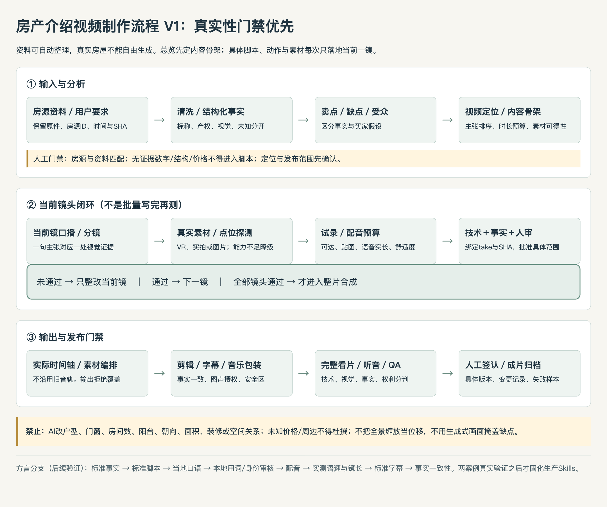

# 房产介绍视频制作流程 V1

> 2026-10-05，规范文档V1候选；来自[第一房源过程](03_第一房源真实生产过程.md)及[复盘规则](04_第一房源经验与真实性规则.md)，用于第二案例验证。**文档完成不等于端到端流程或Skills已经稳定。**
> 适用普通话核心卖点短片/真实带看；按资料、定位及授权选择真实实拍/VR/图片路线。没有3D素材时不强行重建；没有真人或数字人授权时不加入。当前不会生成新脚本、配音或成片。

## 1. 标准流程与逐镜闭环

标准主链：**房源资料 → 信息整理/事实核验 → 卖点与缺点 → 受众假设/内容策划 → 当前镜口播与分镜 → 真实空间/素材与试录 → 审核后下一镜 → 配音与实际时间轴 → 视频编排/剪辑/字幕音乐包装 → 全片QA → 人工签认/归档。**

内容骨架可以先确定；不能先生成整套具体台词、运镜坐标和未经实测的30/60秒全案。第7–11步按当前镜循环，而不是先写完全部脚本再录。

## 2. 输入合同（按房源隔离）

| 输入组 | 至少需要 | 缺失时如何处理 |
|---|---|---|
| 房源身份/基础 | 房源ID、城市/小区、来源页面/文件、采集时间；面积/户型/朝向/价格须单位和字段出处 | 不从目录名猜户型/价格；无资料的字段为null/unknown，冲突单列 |
| 户型/空间 | 原户型图、图片、VR/3D入口或真实视频；来源与同一房源关系 | 图面可见与尺度测量分开；无VR就按真实图片/实拍路线规划，不伪造漫游 |
| 中介/声音/身份 | 中介身份、形象/声线授权、联系方式公开范围、讲解风格 | 没有则匿名房屋讲解；不能克隆或伪装经纪人；禁止将Key纳入资料 |
| 小区/周边 | 可核实小区资料、交通商业配套、来源日期与距离口径 | 没证据就不讲；提学校需单独核证政策/资格，不能把邻近学校写成入学保证 |
| 用户与发布 | 定位、目标平台、画幅/时长、是否方言/出镜、预算、素材与发布许可 | AI提出备选；人确认后冻结版本。60秒只是可能规格，不是默认目标 |

原件不动；派生文件用新名字与新哈希登记。事实级别至少区分`source_declared`（来源标称）、`visually_observed`（可见）、`authoritative_verified`（权威核证）、`inferred`（推断）、`unknown`、`conflicting`。公开宣传只使用已满足对应来源门槛的主张；AI推断不能伪装已核事实。

## 3. 角色与成熟度

责任角色是职责分工，不宣称本轮启动多Agent：**H业务负责人/用户或中介**，**A资料与内容编排助手**，**X采集/配音/渲染执行器**，**R实际看片与事实/权利审核者**。同一人可以兼角色，但机器结果不能替H/R业务签认；本轮未调用子Agent。

成熟度独立于阶段状态：**M0**仅设想/无本案产物；**M1**一案例有手工过程，存在缺口；**M2**一房源具体配方有对应运行/审核证据；**M3**两个真实房源同接口完成且有失败分支；**M4**版本化Skill在新会话重复运行通过。当前整体仅M1，部分单项方法M2；没有M3/M4生产流程。

## 4. 每一步输入、输出、责任与门禁

| 步骤 | 输入 | 必须产出 | 负责 | 自动化 | Skill候选（非定稿） | 必须人工审核 | 当前成熟度 |
|---|---|---|---|---|---|---|---|
| W01 资料清点/身份匹配 | 原目录、房源ID、页面/用户要求 | 文件清单、SHA/类型/原件路径、来源时间、房源关联、权限范围 | A，H确认身份 | 清单/哈希可；身份冲突不能自动放行 | 资料接收/解析职责 | 是，首次身份/权限与冲突 | M1；获取户型图完整轨迹仍缺 |
| W02 信息清洗/结构化 | W01原件、户型标签/文本 | 字段、原文、证据locator、单位、时间、置信边界；未知/冲突不补值 | A | 可提取、标准化与一致性检查 | 资料解析职责 | 是，关键字段/提取错误 | M1；换房源接口本轮开始验证 |
| W03 事实核验 | W02、权威材料/原图/现状 | 可用事实表、冲突/禁用主张表、真实性约束 | A检测，H/R裁决 | 可找冲突/证据缺口，不可自动产权认定 | 事实核验/真实性QA共用规则 | 是，面积结构价格/交易及权利 | M1；本片12米等未闭环 |
| W04 卖点/次卖点/缺点 | 可用事实、真实可见内容 | 主张ID→事实ID→可见证据；排序理由；缺点与验证项 | A提出，H确认 | 可辅助，不生成新房屋事实 | 卖点分析职责 | 是，宣传尺度/完整性 | M1；无转化测试 |
| W05 目标客户假设 | 户型功能/价格条件与真实需求 | 需求型受众、匹配理由、排除条件、待访谈/预算信息 | A，H | 可提出假设；不能充当客户数据 | 客户分析职责 | 是，适配/预算/偏见检查 | M0–M1；第一案无独立客户研究 |
| W06 定位/叙事骨架 | W04/05、素材可得性/平台 | 核心卖点短片或完整带看、推荐时长与预算、覆盖/不覆盖、CTA服务边界 | A，H冻结 | 可生成备选 | 视频策划职责 | 是，定位与预算/规格 | M1；原30–45秒与实片偏差未签认 |
| W07 当前镜口播/分镜 | 已确认一个主张、现有素材 | 当前镜台词、LOOK AT、可见主体、证据词、目标镜长和失败降级 | A | 可拟当前镜，不批量写全案动作 | 口播/分镜职责视接口决定拆合 | 是，事实与当前镜目标 | M1；历史全案预写风险须改 |
| W08 当前素材/3D能力探测 | 当前镜、图片/视频/VR入口、许可 | 房间/点位映射、可达/可见证据、工具/原生高度/FOV边界、所需补材 | X，A | SDK/文件检查可；空间可用性须实测 | 真实空间探测职责 | 是，房源、几何/采集许可；例外单房源 | M2仅旧房源单项；新房源未测 |
| W09 试录/整改 | W07/08、当前动作和执行许可 | 新take视频、遥测、技术检查、采样/切点查看、失败原因/安全降级 | X，A/R | 采集/技术check可；视觉不能只看退出码 | 运镜执行/检查职责 | 是，每次当前镜/版本；失败不推进 | M2仅具体旧配方，净空未量测 |
| W10 口播/配音适配 | 当前镜标准稿、声线/身份授权、音频预算 | 实测语音、文本/音频版本、时长/留白；方言另走后续分支 | A/X，H/R | TTS可；语言自然度、声音权利不可自动签认 | 配音与文本一致性职责 | 是，声音授权、完整听音/语言 | 普通话M1；方言/数字人M0 |
| W11 当前镜冻结/正式素材 | 可接受试录/语音或获准重录 | 当前镜批准范围、素材SHA、实际镜长、recipe版本；继续下一镜或结束镜头循环 | H/R签认，A登记 | 可打包/验哈希，不自动批业务批准 | 版本门禁可共享，不为每步硬造Skill | 是，具体镜/版本 | S4有明确用户批准；全流程M1 |
| W12 编排/剪辑/包装 | 全部获准原片、实际音频、字幕/音乐/字体许可 | 实际时间轴、素材/字幕清单、合成参数、工程/脚本依赖、新版候选MP4 | X，A | 拼接/字幕/测量可，禁止固定路径覆盖 | 素材编排/生成职责优先复用工具 | 是，空间事实/文字、声音/画幅 | M1；脚本固定路径需改造 |
| W13 全片QA/业务审核 | 指定候选SHA、事实主张/规格/权限清单 | 技术/视觉/事实/权利/人审分项结论，完整看片/听音记录、修订请求 | A自动，H/R实际审核 | 可检测时轴/字段/编码；仍有人工判断 | 成片QA＋真实性规则可共享 | 是，终片不得由实现者自我批准 | 技术子项M2，业务闭环M1 |
| W14 签认/交付/复盘 | W13各项、用户指定接受范围 | 版本化成片、事实/素材/依赖包、变更和批准记录、有效/失败样本、状态/LOG | H批准，A交付 | 可归档/哈希/投影 | 共享交接职责，非必独立Skill | 是，发布/需求偏差/权利裁决 | M1；本片最终收尾未完整签认 |

循环中配音可以先试读/测时长，再决定是否调用获准TTS；没有预算和声音许可时用人工估读作为计划值，不能称实际语音。试录若本身可作正式素材，批准该take即可，不为形式重复生成。

## 5. 输出包（不只是一条MP4）

| 输出类 | 最低内容 | 验收意义 |
|---|---|---|
| 房源结构化资料 | 身份、字段证据、时间/单位、已知/未知/冲突、真实性约束 | 能解释每个事实从哪里来；第一房源事实绝不漏到第二套 |
| 卖点与策划 | 核心/次卖点、缺点、需求型受众、定位、时长理由与覆盖范围 | 决定讲什么、不讲什么，不把推断当现状 |
| 脚本/分镜/运镜蓝图 | 内容骨架＋逐镜通过后累积的台词、LOOK AT、recipe与许可 | 蓝图是实测后累积结果，不是一键执行的未测全案 |
| 素材/口播/实际时轴 | 清单、SHA、点位、取材方式、音频实长/字幕对应、音乐/形象授权 | 能定位返工与版本漂移；输出拒绝覆盖 |
| 工程/候选/最终成片 | NLE工程或脚本＋依赖＋素材时间轴；候选和最终版本分开 | 没有NLE工程时如实记录脚本工程；不是只有“终版.mp4” |
| 审核/迭代记录 | 技术、视觉、事实、权利、人类批准、差异处置、耗时/成本/失败原因 | 可复盘、可追踪、可在第二案例验证同一接口 |

## 6. 开始第二套实际制作前的硬门禁

| 门禁 | 必须满足 | 当前本轮如何处理 |
|---|---|---|
| G-P0 第一案收尾 | 无来源主张有处置，实际音画/字幕终审，规格偏差明确签认；不冒称原要求全通过 | 本轮列清单与证据，等待业务决定，不重剪 |
| G-ID 新房源身份/事实 | 资料与104119325592匹配；面积、格局、朝向、价格等关键冲突有清楚处理，未知不写进稿 | 在复盘完成后仅做初始化/候选事实表 |
| G-ASSET 素材能力/权限 | VR/图片/视频真实属于新房源，能取材；许可、图声/人物/音乐字体已确认 | 初始化先盘点，不在线录制或下载模型 |
| G-BRIEF 内容范围 | 确认定位、时长、平台、普通话/方言、是否中介出镜、预算与CTA兑现 | 本轮给建议，不替用户冻结 |
| G-ONE 当前镜准入 | 只确定第一镜的真实主张、候选动作和测试范围；当前镜通过再推进 | Phase4/5另获授权后开展，不输出当前全套台词/坐标 |
| G-VERSION 可追踪输出 | 新版本目录/参数、拒绝覆盖、实际时轴、可复算SHA与LOG | 固定旧脚本不能直接跑；先明确适配/修改方案 |

未满足门禁时仍可复盘、只读整理和讨论；不能开始新录制、TTS/数字人/生成、全片剪辑、发布或付费。只有“可初始化”不等于“可生产”。

## 7. Workflow V1与Skills V1不是同一个东西

本文件把第一案例观察变为待验证流程，第二房源验证输入异质性、卖点重排、素材降级、逐镜闭环、实长时间轴和真实性QA。只有两个案例真实运行后，按重复职责、失败分支及独立验收决定Skill数量/边界。已有官方贝壳Skills与ffmpeg/MMX可作为依赖，不宣称它们覆盖本工作流。

进入Skill V1前应有：同一职责在两个房源的完整输入输出、至少一个失败/拒绝例、事实不变的正反检查、人工门禁、无覆盖/无明文凭证、清楚工具/依赖/权限、全新会话成功重放、版本和回滚/停止说明。本轮仅规划，未创建任何生产`SKILL.md`或Pi扩展。
