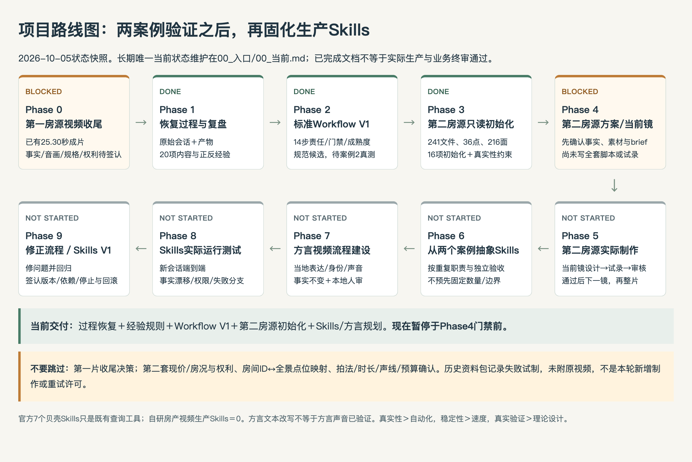

# Skills建设路线与方言房产视频工作流规划

> 2026-10-05规划文档；不是已经实现的Skill或新的执行许可。**第一案例发现流程，第二案例验证流程，两个案例实际制作与审核之后才真正固化Skills。**具体数量/名称/拆合不现在冻结。
> 官方7个贝壳Skills是已安装查询工具；自研视频生产Skills当前0、方言生产运行0。安装工具不等于户型获取/生产流水线已重放。

## 1. 从两案例走向Skills V1

这是本次路线快照，不是第二套实时状态；唯一当前状态仍见[00_当前](../../00_入口/00_当前.md)。

| 进程 | 第一个案例提供什么 | 第二个案例准备验证什么 | Skill候选/进入条件 |
|---|---|---|---|
| 先恢复过程 | 用户逐镜反馈、脚本/原片/遥测/TTS/剪辑、真实失败与部分批准 | 同样保存输入、主张、take、输出、反馈和变更；不只保存终片 | 可追踪能力与共享门禁先于包装 |
| Workflow V1 | 房间五步法、点位/主张/画面绑定、真实性与部分冻结边界 | 168.39㎡新资料/36点/3阳台、价格时效、不同家具遮挡、编号命名空间及素材降级 | 用相同职责输入输出运行；旧参数/高度例外不移植 |
| 第二套真实制作 | 第一套只验证单房源配方，不证明通用成功 | 单镜试录、失败降级/人工许可、实长配音/字幕、整片QA与签认、费用/返工 | 未实际生产之前，不能认为“两案例已验证” |
| Phase6抽象 | 明确有效/无效与人工边界 | 比较两套同接口的差异、反例和真实耗时/成本 | 只封装真正重复、边界稳定的职责；必要时拆分或共用守卫 |
| Phase7方言建设 | 普通话TTS示例，未验证武汉话 | 选择真实地方/中介风格、当地表达者审稿与声音试验、事实不变与声镜一致 | 先文本/声音/权利小试，不用“翻译”一键声称方言完成 |
| Phase8实际运行 | 旧方法库测试只认证旧房源对应范围 | 新会话端到端、原件保护、故障/缺失/越权/事实漂移拒绝、输出不可覆盖 | 候选Skill可以在此测试，不把候选叫稳定V1 |
| Phase9修正与V1 | 第一案遗留须作为回归例 | 修已观察失败，重新验收，固定依赖/版本/权限/停止/回滚说明 | 最终用户签认通过后才命名生产Skills V1 |

两案例目前同城市同小区，不认证跨城市/跨平台/全部房屋通用性。进一步扩域要另取授权与案例，不靠目录名称扩大声明。

## 2. 职责候选池：不是13个定稿Skill

| 职责 | 已有经验/工具 | 必须积累的第二案例证据 | 自动化与人工边界 |
|---|---|---|---|
| 资料接收/解析 | 台账、目录/图片/JSON、官方贝壳物料工具候选 | 本地包/页面差异、未知/冲突、房源身份、原件/时效 | 可清点/提取；身份与冲突需人审 |
| 房源事实核验 | 核心事实口径、证据/哈希、禁止几何推断 | 现价、168.39与标签和、设备/周边、编号空间 | 规则/字段比对自动；产权/发布资格不由模型决定 |
| 卖点分析 | 主张→视觉证据、去浮夸词 | 三阳台/客餐关系的新排序和缺点，不复制旧浴缸 | 建议可自动；商业判断/真实性要签认 |
| 目标客户分析 | 改善家庭需求假设，无客户数据 | 真实需求/预算/平台反馈；明确假设与排除条件 | 不把假设伪装受众调研，不推敏感人口标签 |
| 内容策划 | 核心短片与完整带看区分、CTA | 用户选真实分空间或补实拍、目标时长/覆盖 | 人批准定位与成本；骨架不是全量动作脚本 |
| 口播脚本 | 每镜密度、事实词、实际语音预算 | 数字/限定词一致、不同语速与留白、版本差异 | 只拟当前镜；台词必须对应同房源证据 |
| 分镜设计 | LOOK AT、主卧/浴缸焦点、删冗余 | 新房间映射、不同遮挡、片段的新增信息 | 合格才下一个；不能先批量全案再实测 |
| 真实3D/VR运镜 | Five SDK、Canvas、可用旧单配方 | 36点映射、贴图加载、原生高度/可达、原生定点 vs 跨点失败 | 采集与check可自动；视觉/几何/例外人工审核 |
| 方言口语改写 | 本轮仅建立流程与公开文档边界 | 本地词/语法/语气/身份审稿＋主张对照 | 不能擅加价格/面积/朝向/服务承诺 |
| 配音生成 | MMX普通话/6段实长；本片没有真人或方言实证 | 授权音色/真人、读音/情绪/实长、本地听音 | 新服务先预算/许可；不得无授权克隆或自称实录 |
| 素材编排/剪辑 | Pillow/FFmpeg脚本及字幕返工 | 防覆盖、实长时间轴、字幕安全区/音轨版本、权利 | 优先既有工具，不新造全能视频生成器 |
| 成片审核 | 编码/解码/PTS与采样、人类部分批准 | 完整看片听音、指定SHA、需求偏差与最终业务签认 | 技术QA是子项，不代替业务/权利审查 |
| 房产真实性QA | TR-01–18、事实漂移拒绝 | 普通话/方言/音轨/字幕/画面同源，错房/错价/错点拒绝 | 可共用规则/检查器，不必为了列表独立造一个包 |

何时合并：同一输入输出、同一失败边界/负责人且无法独立验收；何时拆分：独立权限/生命周期、独立数据或人工门禁，或只在部分场景加载。先看两个案例，再选择最小可维护边界。

## 3. 复用现有能力，不为了写Skill写Skill

- 本机已有官方贝壳7包、MMX、浏览器/SDK和FFmpeg/Pillow；可以作为后续候选依赖，本轮没调用贝壳业务接口、TTS或媒体生成，未测试它们完整接手新流程。
- 本轮npm检索发现`pi-multix`与`@amaster.ai/pi-video-gen`等媒体包候选：[pi-multix](https://www.npmjs.com/package/pi-multix)、[pi-video-gen](https://www.npmjs.com/package/@amaster.ai/pi-video-gen)。**未安装、未审查源代码、未选为生产依赖**；[检索凭据](../../04_测试与验收/流程升级核验/现有Pi媒体包候选-20261005.json)只是npm描述/版本线索。能生成视频不等于保持房屋几何/事实，也不代替房产真实性规则。
- 未来真正写Skill时重新核对成熟包和依赖，读skill-authoring/Pi规范；当前不新建`SKILL.md`、扩展、工具、工作流调度器或竞争事实数据库。
- Skill不是预设“自动跑到底”的脚本，而是明确触发/输入/输出/房源namespace/依赖/许可/停止条件/人审门禁/证据与回滚的可重放职责。共享事实/QA规则优于各Skill各自编一套事实。

## 4. 方言完整链路与责任

**标准事实 → 普通话标准脚本 → 当地表达习惯 → 方言口语化改写 → 用词/数字/地名检查 → 中介身份/风格适配 → 获准TTS或真人 → 实测语速与镜长 → 标准字幕 → 事实一致性 → 本地听审/整片业务终审。**

| 步骤 | 输入 → 输出 | 谁负责 / 必须核验 |
|---|---|---|
| D01 固定事实 | 事实ID/可用来源 → 不可改的数字、格局、方向、价格时间、未知清单 | A记录、H/R批准事实与口径；先建立“不能改什么” |
| D02 标准脚本 | 已准入当前镜/事实 → 普通话当前镜稿与主张ID | A拟稿，人审主张/语音预算；不是整套未测脚本 |
| D03 地方表达 | 指定地区、受众、真实中介风格、本地说话样本 → 词汇/语气/语法可用表 | 本地表达者审；武汉房源不自动意味着必须武汉话或同一种口音 |
| D04 口语化改写 | D02/03 → 保留事实ID的方言候选与逐句改动理由 | 不仅替词；改变句式/礼貌/信息顺序但不改事实，不以“土味”代专业 |
| D05 用词检查 | 方言候选 → 地名/数字/面积单位/多音词/敏感夸张检查与退回项 | A检测＋本地人审；没有本地审者不能称地道 |
| D06 身份适配 | 真实姓名/身份/风格/声音/形象授权 → 出镜/匿名/合成声明与语气版本 | H/权利人确认；不要把第一案女声当新中介本人 |
| D07 声音路线 | 审稿与授权/预算 → 真人录音或限定一段TTS试音 | 优先能核实的授权真人；TTS不自然则降级/暂停，不靠克隆陌生人 |
| D08 声镜匹配 | 真实音频、当前镜实际时长 → 起止、停顿/留白、修稿/重录决定 | 用实长而非字符均值；字幕不强行挤满、禁止截断事实限定语 |
| D09 标准字幕 | 审核语音/方言稿 → 普通话可读字幕＋经同意保留的本地表达 | 数字/约/否定/价格日期不能丢；完整字幕与营销大字分开 |
| D10 同源QA | 标准事实、普通话/方言/音频/字幕/画面 → 差异表、自动拒绝＋人工听审 | 地名/数值/布局/朝向/设备/服务不新增、不夸大；ASR只辅助，不能代本地听审 |
| D11 归档回归 | 通过的具体版本 → 对齐文本、音频/视频SHA、声线许可、本地意见、失败/降级及成本 | 更新状态/LOG；下次换房源/中介/方言重测，不复制旧accept |

## 5. 当前方言能力边界与来源

本轮只核对公开[MiniMax同步语音文档](https://platform.minimaxi.com/docs/api-reference/speech-t2a-http)和[系统音色列表](https://platform.minimaxi.com/docs/faq/system-voice-id)，详见[文档核对凭据](../../04_测试与验收/流程升级核验/方言能力文档核对-20261005.json)。

- 同步语音文档的`language_boost`列出`Chinese`、`Chinese,Yue`等，包含字音修正及句/词时间戳；音色表把本片`Chinese (Mandarin)_Warm_Bestie`标为普通话。
- 这次获取的官方枚举/音色列表未找到武汉/Wuhan专用项；**不能据此承诺武汉话合成已支持，也不能断言所有模型永远做不到。**必须获准后以本地人实际听音判断。
- 官方文档支持普通话/粤语拼音或IPA纠音，不等于本地自然口语、正确身份或完整方言流程。
- 克隆参考URL本轮404，不用它支持能力/授权结论；任何未来克隆先重新查有效说明及取得发声者明确权利。当前完全没有真人声音克隆、TTS试音或方言视频测试。

## 6. 方言验收与失败降级

| 必须通过 | 失败例 / 要拒绝什么 | 如何处理 |
|---|---|---|
| 事实同源 | 168.39变163；约/否定丢失；历史价称现价；3阳台变双阳台；擅加浴缸/湖景/学区 | 拒绝当前稿，回标准事实；数值简写只可用人工批准的舍入口径，不由模型随口改 |
| 本地自然 | 方言字面读成普通话、口音不一致、冒犯或刻意装身份 | 本地人退回；改口语表或授权真人，不自称“地道” |
| 主体身份/权利 | 无授权声线/人物、合成伪称中介原声 | 暂停该路线；匿名获准普通话或补权利，不能绕过 |
| 时间轴 | 语音超镜长、限制语截断、字幕与口播不同步、放快后难懂 | 缩当前稿/重录或调整已准入镜头；重新听音，不用旧音轨 |
| 可读字幕 | 方言黑话导致外地人无法理解；面积/价格/单位缺失；营销大字增加事实 | 标准化字幕并保持主张，完整字幕与营销字分别审 |
| 房屋真实 | 配方为“配音适配”却生成/修改室内门窗家具或空间 | 拒绝媒体，保留真实素材，不允许用声线任务改变房子 |

本地人自然度、真实声音权利与完整听音不能仅用模型打分替代。当前没有这些实测数据，不发布方言Skill V1。

## 7. Skill V1实际运行测试合同（未来执行）

- 正例：同接口分别读取两房源，产物能追溯至对应原件/事实/版本，正确执行一项获准动作与后续人审门禁。
- 负例：错房源/错房间编号、哈希漂移、无来源价格、缺画像/素材、未经允许TTS/人物/付费、旧高度例外、空间幻觉、既有输出覆盖；全部应停止对应下游并留下原因。
- 新会话：由Skill说明与依赖恢复，不需要原聊天暗示；缺登录/验证码交人，不保存Key，不提升权限、换工具掩盖失败。
- 生产闭环：完整事实/配音/字幕/画面一致、逐镜审核、最终指定SHA签认；合成成功或旧23项方法测试不能替代这一验收。
- 量化记录：实际耗时/成本、人工审批次数、返工原因、事实/素材匹配率、自动拒绝的误报/漏报。先真实性和稳定性，自动化率只作辅助指标。
- 版本：候选失败留存，修复有变更依据与回归，新依赖/房源/方言变更不继承旧接受；Phase8测试后再在Phase9固化V1并提供停止/回滚。

本轮最重要的不是增加包数量，而是明确“第一案哪些结论可继承、第二案要证明什么、哪些结论现在还不能声称”。
