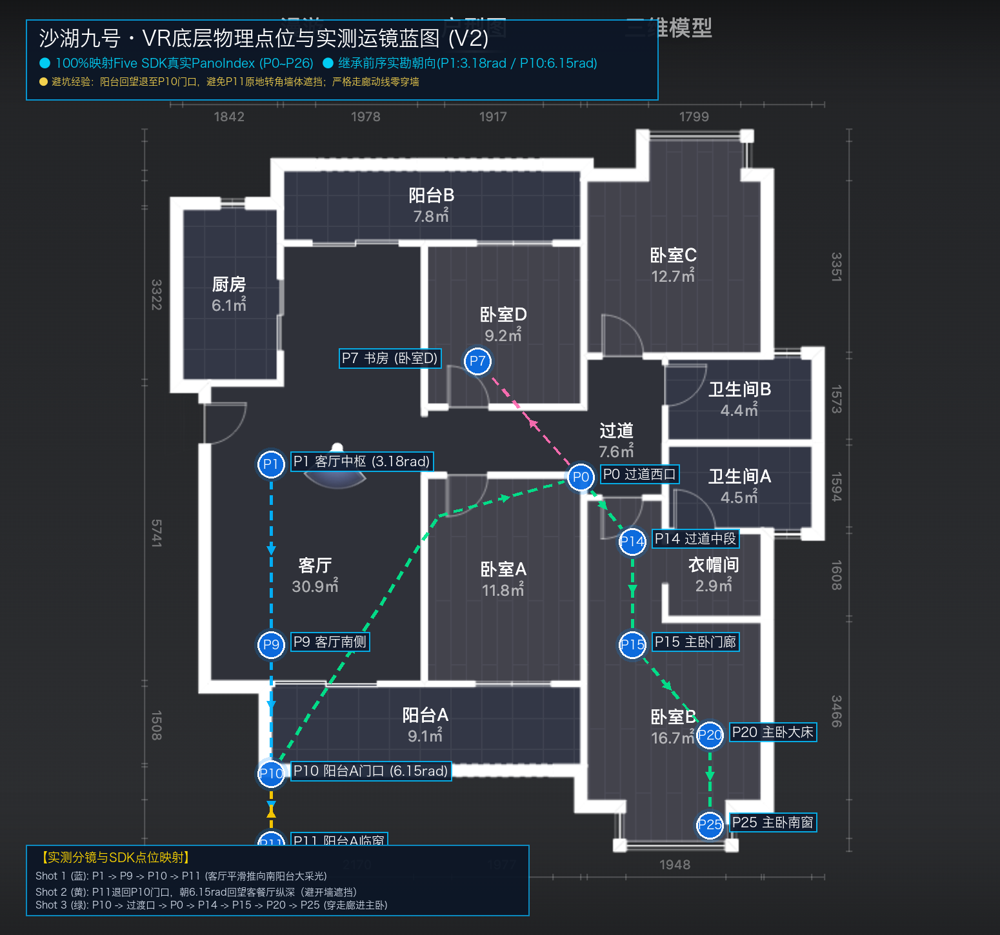

# 沙湖九号 · 视频脚本框架与镜头运镜路径规划提案 (V2 实测升级版)

> **重大更新**：本方案已全面吸收并融合了前序工程的真实实测资产与避坑教训：  
> - `04-v1.0视频/模拟真人VR浏览` (Five SDK 驱动、fly 同步转向、防叠影诊断)  
> - `05-测试/沙湖九号-全屋带看` (27个全景点位拓扑真实数据)  
> - `05-测试/沙湖九号-宣传短片` (D1/D2取景实勘：P1取3.18rad、P10门口取6.15rad回望)

---

## 1. 摄像机物理点位与实测运镜蓝图 (Blueprint V2)

### 汲取的核心实勘与避坑经验：
1. **100% 对应如视 Five SDK 真实点位 (P0~P26)**：
   - 彻底告别虚拟不可落地的机位，所有点位均有真实点云与全景支撑；
2. **构图避坑（前序实勘血泪经验）**：
   - **P1 客厅构图**：旧版 0.45rad 会正对厨房门与窄墙，**实勘已验证必须设为 3.18rad**，正对客厅大开间与阳台A开敞门洞；
   - **阳台回望构图**：在 P11 临窗处原地转身会被阳台侧墙严重遮挡（废镜头！）；**实勘已验证必须退回门口 P10，朝 6.15rad 回望**，方能一览客餐厅超大纵深！
3. **真实走廊动线，绝对零穿模**：
   - 进入主卧套房的动线严格顺应：`阳台门口 P10` $\rightarrow$ `客厅门洞` $\rightarrow$ `过道西口 P0` $\rightarrow$ `过道中段 P14` $\rightarrow$ `主卧门廊 P15` $\rightarrow$ `主卧大床 P20` $\rightarrow$ `主卧南窗 P25`；
   - 避开所有实体墙，保证画面不穿墙。

---

## 2. 视频分镜与口播脚本规划 (标杆 34 秒高转化结构)

| 镜头编号 | 物理点位 (SDK Pano) | 运动方式与朝向 | 关键画面构图 | 口播文案拟案 (MMX温暖女声, 语速0.96) | 屏幕大字幕 (黄色强调) | 时长预估 |
|---|---|---|---|---|---|---|
| **Shot 0** (定题闪卡) | P1 | 定格闪卡 | 室内实景 + 户型图轮廓叠加 | （吸睛卡点音效） | **沙湖九号 · 约163㎡** 【4室2厅 · 南北双阳台】 | 0.0s ~ 0.8s |
| **Shot 1** (客厅推镜) | `P1` $\rightarrow$ `P9` $\rightarrow$ `P10` $\rightarrow$ `P11` | fly 平滑推进 (位置与朝向同步，朝南偏西) | 31㎡大横厅通透采光，直推至 9.1㎡ 巨幕南向大阳台与窗景 | “在武昌沙湖核心，走进这间约163平的大平层，第一眼就是超过30平的奢阔横厅与落地大阳台……” | **约163平 沙湖核心** **31㎡大厅 直连9.1㎡巨幕阳台** | 0.8s ~ 7.5s |
| **Shot 2** (尺度回望) | `P11` $\rightarrow$ `P10` 门口 | 退回门口平滑转向 (终点朝向 6.15rad) | **站在阳台门口看客厅全貌**，展现超大进深与开阔感（避开近墙遮挡） | “沿阳台回到门口，回头看客餐厅，南北通透，四开间朝南，从容装下全家人的生活。” | **超大纵深** **回头看客餐厅** | 7.5s ~ 14.0s |
| **Shot 3** (互动代入) | `P10` $\rightarrow$ `P0` (过道西口) | 走向过道枢纽 (朝向 0rad 引导视线) | 动静分区门廊，展示动区与静区交界 | “这样一个通透大平层，你会怎么布置你的客厅和书房？” | **这个空间** **你会怎么布置？** | 14.0s ~ 17.5s |
| **Shot 4** (私密尊享) | `P0` $\rightarrow$ `P14` $\rightarrow$ `P15` $\rightarrow$ `P20` $\rightarrow$ `P25` | 穿过道平滑推进主卧 (朝向东南大窗) | 24㎡豪华主卧套房，双向采光落地窗，回望带独立衣帽间与私享主卫 | “穿过动静分区走廊，主卧做到了24平的豪华独立套间，独立衣帽间配私享主卫，私密感拉满。” | **24㎡豪华主卧套房** **独立衣帽间 + 私享主卫** | 17.5s ~ 28.5s |
| **Shot 5** (行动引导) | `P25` (主卧窗边微摇) | 定点微摇或户型图动画 | 主卧阳光落地窗与温馨居家质感 | “想体验这套房子的完整全景漫游吗？评论区留下【沙湖九号】，带你在线看全屋！” | **评论留【沙湖九号】** **看完整全景漫游** | 28.5s ~ 34.0s |

---

## 3. 技术执行方案 (对比 Computer Use 与 SDK 脚本)

前序工程已经证明了最稳定、最丝滑的技术路径：
- **方案 A（首选/前序验证最佳实践）**：
  直接在浏览器页面控制台或通过 CDP / Playwright 调用 Five SDK 的 `five.moveToPano(panoIndex, { effect: 'fly', duration: ..., longitude: ..., latitude: 0, fov: 95 })`，配合 `canvas.captureStream(30)` 原生录屏，稳定达到 **29.95 fps 零掉帧**！
- **方案 B（Computer Use 前沿探索）**：
  使用 Computer Use 模拟鼠标点击地面小白圈导航。优点是纯黑盒用户视角，但前序实验发现存在点歪、被遮挡、卡顿等边界问题。
- **推荐策略**：
  在 Step 4 中，我们可以先用 Computer Use 测试基本交互与视角可达性；而在实际录制视频时，直接启用 SDK 脚本保证工业级稳定成片！
