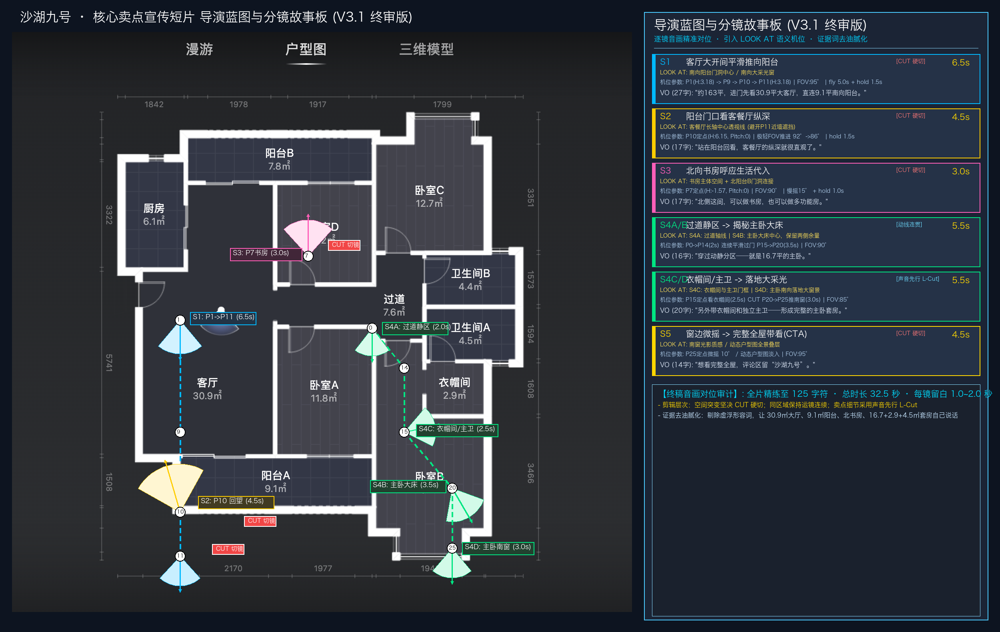

# 沙湖九号 · 核心卖点宣传短片 导演蓝图与分镜台本 (V3.1 终审版)

> 2026-10-05定位说明：保留下文作为历史设计蓝图与32.5秒预算，不把“终审版/100%一致”解释为当前五镜原片、25.30秒成片或新场景的等价执行配方。Shot4后续路线、时长及字幕已变更；现有证据与复用入口见[六步证据地图](../05_资产库/07_制作流程资料/01_六步流程与证据地图.md)，执行仍受单镜测试与授权门禁约束。本次不修改冻结导演合同或原图。

> **定位**：沙湖九号·核心卖点短片（约 32.5 秒）  
> **核心法则**：**每镜必有证据词 · 引入 LOOK AT 语义机位 · 剔除浮夸修饰语 · 逐镜音画精准留白**。

---

## 1. 导演蓝图总览 (Director Blueprint V3.1)

---

## 2. 逐 Shot 音画节奏与视觉证据审计清单

| 镜头编号 | 时长预算 | 剪辑类型 | 语义目标 (LOOK AT) | 动作与机位六元组 | 精简口播台词 (VO) | 语速与呼吸留白 | 视觉证据链条 |
|---|---|---|---|---|---|---|---|
| **S1** | **6.5s** | **[CUT 硬切]** | 南向阳台门洞中心 / 南向大采光窗 | `P1(H:3.18) → P9 → P10 → P11(H:3.18)` FOV: 95° · fly 5.0s + hold 1.5s | “约163平，进门先看30.9平大客厅，直连9.1平南向阳台。” (27字) | 播报约 4.5s **留白 2.0s**（静享南向大采光） | **证据1**：第一眼建立30.9㎡大横厅尺度与9.1㎡巨幕大采光 |
| **S2** | **4.5s** | **[CUT 硬切]** | 客餐厅长轴中心透视线 (避开P11近墙) | `P10 门口定点 (H:6.15, Pitch:0)` 极轻 FOV 推进 92° $\rightarrow$ 86° · hold 1.5s | “站在阳台回看，客餐厅的纵深就很直观了。” (19字) | 播报约 2.8s **留白 1.7s**（看清空间开阔纵深） | **证据2**：南北通透长轴，客餐厅纵深感真实震撼 |
| **S3** | **3.0s** | **[CUT 硬切]** | 书房主体空间 + 北阳台B门洞连接 | `P7 书房定点 (H:-1.57, Pitch:0)` FOV: 90° · 慢摇 15° + hold 1.0s | “北侧这间，可以做书房，也可以做多功能房。” (20字) | 播报约 2.2s **留白 0.8s**（嘴提书房眼见书房） | **证据3**：补齐4室证据链，证明功能弹性与北向采光 |
| **S4A/B** | **5.5s** | **[动线连贯]** | S4A: 过道轴线 S4B: 主卧大床中心，保留两侧余量 | `P0 → P14 (过道2s)` 连续平滑过门 `P15 → P20 (主卧3.5s)` FOV: 90° | “穿过动静分区——就是16.7平的主卧。” (17字) | 播报约 3.2s **留白 2.3s**（看清主卧大床与横向余量） | **证据4**：交代动静分区，Reveal主卧16.7㎡宽敞尺度 |
| **S4C/D** | **5.5s** | **[L-Cut 声音先行]** | S4C: 衣帽间与主卫门框 S4D: 主卧南向落地大窗景 | `P15 定点看衣帽间 (2.5s)` ✂ CUT `P20 → P25 推向南窗 (3.0s)` FOV: 85° | “另外带衣帽间和独立主卫——形成完整的主卧套房。” (21字) | 播报约 3.5s **留白 2.0s**（阳光满屋，从容收官） | **证据5**：实证2.9㎡衣帽间+4.5㎡主卫，合力构成完整套房 |
| **S5** | **4.5s** | **[CUT 硬切]** | 南窗光影质感 / 动态户型图全景叠层 | `P25 定点微摇 10°` 动态户型图卡片淡入 · FOV: 95° | “想看完整全屋，评论区留“沙湖九号”。” (16字) | 播报约 2.5s **留白 2.0s**（给足买家行动留资时间） | **证据6**：卖点心智建立后，趁热打铁闭环全屋转化 |
| **合计** | **32.5s** | - | - | - | **全片精炼至 125 字符** | **平均 3.8 字/秒**（极度从容自然） | **全案形成坚固完整的买家信任证据链** |

---

## 3. 商业调性与证据化去油腻规范
1. **彻底摒弃销售套话**：
   - 严禁出现“总统级套房”、“豪宅气派”、“极其震撼”等自嗨式浮夸词汇；
   - 统一使用克制、客观的**事实证据词**（如：“客餐厅的纵深就很直观了”、“形成完整的主卧套房”、“完整展示横向尺度和床体余量”）。
2. **三层剪辑手法分层落地**：
   - **空间突变（大转场）**：坚决使用 **HARD CUT 硬切**，节奏干净利落；
   - **同一区域探索**：保持 **运镜连续（Motion Continuity）**，自然过渡；
   - **细节卖点展示**：采用 **声音先行（L-Cut）**，文案提前 0.3s 切入，声音带节奏，画面给证据。
3. **技术可复现性（机器合同保障）**：
   - 本台本与 `02_架构与合同/05_导演机位与剪辑合同_V3.json` 保持 100% 数据一致，随时可通过自动化脚本与 Five SDK 无缝执行。
