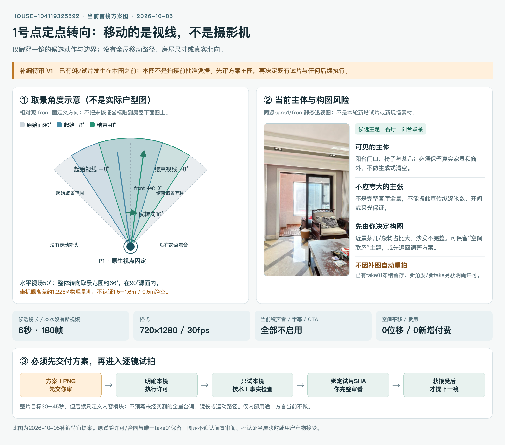

# 第二房源拍摄计划方案 V1 · 待审

> **2026-10-05补编候选，不是拍摄前已交付或已批准的方案。**用户指出应先收到拍摄计划与运镜示意图；此前助手取得一次具体试验许可后直接生成了6秒试片，遗漏正式方案/图示的交付审阅。现在停止制作，保留试片和原始许可，不回填历史，不将试片或本文件记作接受。
>
> 本文件只用于**先审方案**。整体内容骨架可先定；仅当前首镜列具体参数，后续镜头待前一镜实测和人工接受后再逐一设计。全项目实时状态仅见[00_当前](../../00_入口/00_当前.md)。

## 1. 先确认拍什么

| 项目 | 本方案口径 | 需要保留的边界 |
|---|---|---|
| 房源 | 武汉104119325592，HOUSE-104119325592 | 与上一套163㎡/27点房屋隔离；不混用画面、点位或旧批准 |
| 目的 | 内部研究制作的真实分空间VR短片 | 不是商业公开广告、现场新拍或完整真人连续带看 |
| 核心内容 | 客餐与阳台的空间联系、真实房间的生活分工 | 不靠无来源尺寸、材质、设备功能或保证采光作卖点 |
| 整体时长 | 30–45秒目标 | 当前只有6秒首镜候选；不为凑时长先写完整台本/全套路径 |
| 成片方向 | 竖屏720×1280、30fps | 每镜清晰度与取景需逐一验证，不能承诺全屋连续走入 |
| 声音/身份 | 普通话匿名画外音方向，暂不数字人 | 具体声线与音频来源未定，本轮不配音、不克隆、不冒充中介 |
| 预算 | 零新增付费 | 现有本地FFmpeg/Pillow；不安装新包，不调用收费TTS/生成服务 |
| CTA | 只指向实际可供查看的户型与空间资料 | 内部交付资料确实可提供才写，不承诺约看、交易或经纪服务 |
| 扩展 | 方言当前不做，未来按需扩展 | 非基础流程的必过项，不为取消方言放松事实/声音权利 |

以上多数来自用户此前方向选择；**收到方向不等于正式方案及图示已经审阅通过**。

## 2. 整片内容骨架：先有主线，不预写全套具体镜头

| 内容模块（非执行镜号） | 希望回答什么 | 可用素材/进入下一步条件 |
|---|---|---|
| 身份与真实户型锚点 | 这是哪一套房、空间怎么分布 | 同ID原户型/VR；是否显示面积须单独确认口径，不把图面标签和当产权面积 |
| 客餐与阳台关系 | 公共活动空间与阳台怎样联系 | 已有客厅/餐厅/两处阳台的水平四向视觉线索；**当前只拟一镜**，不先下发跨点路径 |
| 房间生活分工 | 至少一处真实房间如何呈现 | 后续逐点核对再设计；卧室A/B/C/D与面积尚未精确绑定，不能套错标签 |
| 经核证的收纳/卫浴补证 | 需要补充哪种使用分工 | 只采用可见同源画面；不宣传未核证的主卧套房连通、设备运行或材料 |
| 资料型收尾 | 看完可以实际查看什么 | 资料可提供性与权限确认后再写CTA；本次首镜没有CTA |

这不是30–45秒全量脚本：**其余具体点位、运镜路径、每镜时长、台词、声音切点均不在此先冻结**。上一镜没接受时，不提前制作下一镜。内容删减或顺序变化也先讨论，不用算法伪造缺失空间。

## 3. 当前首镜运镜示意：同一点，只有转向

[图源HTML](首镜运镜示意_V1_补编待审.html)仅供查看/维护；PNG是本方案的直接可见图。图中俯视扇形是**取景角度示意，不是实际户型图**，没有房屋尺度、墙体坐标或真实北向；不会把未核证的点位放在原户型上。

### 3.1 本镜设计候选

| 项目 | 候选设计 | 检查/限制 |
|---|---|---|
| 当前主题 | 客厅与相邻阳台门口的连接关系 | 画面并非完整客厅全景，不能以此证明开间、纵深米数或全天采光 |
| 点位与原图 | panoIndex=1、observer.index=1、front真实90°立方体面 | 视觉对照为客厅；不是`listing.rooms.客厅=24`，没有原生room ID |
| 摄影机位置 | 固定原生采集视点，全程不平移 | 不能称向阳台推进、真人行走或穿门；不升高全景伪造视线 |
| 初始/结束方向 | 相对front面−8°→+8°，总转向16° | 不是SDK全局yaw或房屋北向；保留真实像素，不跨源面边界 |
| 俯仰/翻滚 | pitch=0°、roll=0° | 不仰拍/俯拍补造可见范围，不高频晃动 |
| 视场角 | 水平50°，竖屏对应垂直约79.32° | 视场角是透视取景，不叫推进；转向覆盖的水平范围约66°，仍在源面90°内 |
| 候选镜长 | 6秒、30fps、180帧，缓入缓出 | 当前参数来自已经生成的唯一试验，不冒充拍前方案；是否保留由用户决定 |
| 原生视角 | 坐标眼高差约1.226，仅本点本次曾获例外许可 | 不是物理测量，不宣称达到真人1.5–1.6m；0.5m净空仍未认证 |
| 本次声音/字幕 | 静默，无字幕、数字人和CTA | 没有未经核证面积/价格/方向主张，不产生新配音或费用 |

### 3.2 构图风险先说明

- 原有茶几与生活物品占近景较多，沙发只露出一部分；它更像“阳台入口联系”镜头，不足以承载“客厅完整开阔感”。
- 不生成清空杂物、换家具、扩房间或替换窗外。要改变现状，须另取同套授权真实素材。
- 你可以决定：保留这份候选设计，或把首镜主体退回调整。**退回时先改方案/图示，确认后才允许新take；本轮不自动换角度重拍。**

## 4. 事实、素材和权限边界

- 当前镜事实取自[第二套最小档案](../../02_架构与合同/第二房源_104119325592/01_房产核心档案.md)，源图/原字段见[命名空间凭据](../../04_测试与验收/02-武汉104119325592/准入核证01_20261005/命名空间与静态映射证据.json)与[视觉对照](../../04_测试与验收/02-武汉104119325592/准入核证01_20261005/视觉空间与点位对照.json)；第一套冻结合同只读。
- [官方只读查询](04_当前详情查询记录-20261005.json)返回168㎡、500万、在售，但没有数据更新时间；原包168.39㎡精度与2026-03-13的VR记录分别保留。不保证实时价格、可售或现场房况，不把共有产权/抵押/无钥匙来源声明当法律核证。
- 本次素材仅内部用途，查询成功不是商业素材权利证明。未获新的公开许可不发布；私人会话和凭证不上传。
- 36点水平四向视觉分类不等于全部六面360°人审/全屋原生room-ID映射。卧室名称/面积、第三阳台独立画面及连续路径未知，不编造覆盖。

## 5. 以后按这个门禁执行

**先交方案＋PNG示意 → 用户审方案 → 明确当前镜执行许可 → 只试这一镜 → 技术/事实/画面检查 → 用户审试片 → 才提出下一镜。**

1. 方案审阅：确认当前主题、真实取景点、动作、候选镜长、原生视角限制、输出与费用；提出改动时先修订方案，不先重录。
2. 执行许可：批准方案不自动等于批准付费、TTS、全片或下一镜。涉及新点/新动作/新take须明确对应许可。
3. 防覆盖：输入源与合同绑定SHA；新take独立目录，禁止覆盖原片或通过删目录/改ready绕过守卫。
4. 当前镜检查：全量解码、帧数/时长/PTS；同源事实、无缺面黑边/跨点重影/伪推进；明确目视采样范围，米级高度/净空未知不判通过。
5. 人工接受：绑定实际MP4 SHA，用户完整审看构图/速度/真实感。试验许可、机器通过或一句“继续”均不是产物接受。
6. 失败/退回：停当前镜、保留失败/原take；下一版本先修方案与图，再获得许可。不得跳镜、生成补洞或以未证声音填时长。

## 6. 已发生的试验与这次补编的关系

- 用户曾明确批准一次pano1原生定点6秒静默试验，[历史执行合同01](../../02_架构与合同/第二房源_104119325592/02_当前镜试验合同_01.json)与许可原样保留。助手随后直接生成了试片，没有先把正式拍摄方案与图示交给用户，这是**前置交付遗漏**。
- [唯一take01及历史检查](../../04_测试与验收/02-武汉104119325592/S1_客厅原生定点转向/take01_20261005/审看入口.md)，视频SHA`d44acd7598cb675c80eaec3102f96eac5b0d152c5ebd9198cfd82974b2fe8fdf`。技术和有限目视/实播检查完成，但用户未接受；不会因为补编文件而变成“先方案后试拍”。
- 本方案V1/图为**试验之后新建的待审提案**，不是伪造拍前凭据，不修改原合同/旧review/台账注册记录。现有take01冻结留存，不生成第二条视频。
- 目前先审本方案与图；用户确认后再分别决定是否保留既有试片、是否需要改本镜以及相应执行许可。第二镜、全片与声音均不自动开始。

## 7. 这次请先审的三件事

1. 整体定位是否仍为30–45秒真实分空间VR、普通话匿名、零新增付费、仅内部？
2. 首镜用“客厅—阳台门口联系”作主题是否合适，还是应先调整构图/主体？
3. 是否接受本镜仅定点转向、原生视角限制及逐镜方案→试片双审核流程？

**本文件仍待审；读到文件、批准方向或旧试验许可，不等于这份补编方案/PNG或任何新视频已获接受。**
