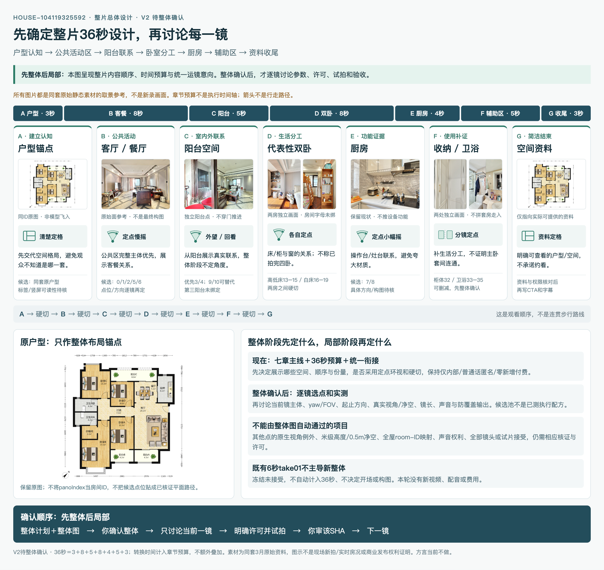

# 第二房源整体拍摄计划 V2 · 待整体确认

> 房源：武汉104119325592。2026-10-05新提案。**先整体后局部：本轮只确认整片计划与整体运镜图，不讨论执行某一镜、不拍摄。**
>
> V1偏重首镜，未满足用户先确定整体设计的要求；本版新建，不覆盖已登记V1、旧许可或已有6秒试片，也不倒写成拍摄前已批准。实时阶段只看[00_当前](../../../00_入口/00_当前.md)。

## 1. 整体方案一句话

建议制作一条**约36秒的竖屏真实分空间VR短片**，按照“户型建立认知 → 客餐公共区 → 阳台空间联系 → 两个代表性卧室 → 厨房 → 收纳/卫浴 → 资料型收尾”的观看顺序，先让观众理解格局，再呈现生活分工。

- 整体目标仍为30–45秒；36秒是**待审内容预算**，不是已完成片长、音频实长或逐帧固定时间轴。
- 仅内部研究/制作，720×1280、30fps；普通话匿名画外音方向，暂不数字人，方言不列必做，零新增付费。
- **分空间定点环视＋空间间明确切镜**，不制造连续走入、穿门或虚假推进。画面保留真实家具/杂物，不换房、不生成清空或改窗外。
- 这是代表性空间短片，不是逐间全屋带看：不声称四卧、三阳台、两卫的全部画面已拍齐。若你需要全屋完整覆盖，应先在整体层调整篇幅与覆盖范围，而不是拍完再补漏。

## 2. 整体运镜与空间衔接示意

图覆盖**整片**，不是只画首镜。缩略图均来自同套原户型/真实VR面，仅用于说明主体，不代表最终取景、已录画面或当日房况。[HTML图源](整体运镜与衔接示意.html)可放大查看；读者PNG已嵌入本方案。

- 图中章节箭头＝剪辑观看顺序；**不是房屋内部可行走路径**。
- 单个空间采用定点取景/小幅慢摇的意向；具体起止角度、FOV、方向、每镜时长、声画切点，留到整体确认后逐镜讨论与实测。
- 原户型只作整体布局参考，不把尚未核证的VR相机坐标贴在平面图上。源面front/back不是北/南方位。

## 3. 整片内容顺序与预算

| 章节 | 建议预算 | 整体观看任务 | 画面/运镜意向 | 与下章如何衔接 |
|---|---:|---|---|---|
| A · 户型认知 | 3秒 | 先识别同套房屋的空间分布 | 原户型清楚定格；优先不做模型飞入、旋转或破面特效 | 明确切入真实VR，避免冒充俯冲入室 |
| B · 客餐公共区 | 8秒 | 建立主要活动区及客餐联系 | 客厅/餐厅定点缓慢环视；优先完整主体，避免近景茶几杂物占满 | 切到独立阳台采集视点，不伪造穿门 |
| C · 阳台联系 | 5秒 | 看阳台与室内的真实关系 | 从阳台内部外望或回看客厅，整体阶段保留取景意向；不预定跨点推进 | 硬切卧室，清楚表达换空间 |
| D · 两个代表性卧室 | 8秒 | 呈现不同生活分工，不只扫窗 | 白床品卧室与高低床卧室各一处展示意向；优先床/柜与窗的关系 | 两房之间和转厨房均用明确切镜，不穿墙 |
| E · 厨房 | 4秒 | 让功能空间有一个清楚证据 | 定点取景操作台/灶台关系，小幅慢摇意向；不宣传设备功能或材质 | 切辅助区，不从门洞硬推 |
| F · 收纳/卫浴 | 5秒 | 补充日常使用分工 | 柜体/衣帽过渡区与一处卫浴候选；两处独立画面，不合成“套房连续走入” | 切回资料页，不制造回屋运动 |
| G · 资料型收尾 | 3秒 | 告诉观众可实际查看什么 | 同套户型/资料静态收尾，清晰简单 | 结束；不承诺约看/成交或中介服务 |
| **合计** | **36秒** | **处于30–45秒目标范围** | **内容预算，不是七条已定执行配方** | **片内转换时间计入预算，不另叠时长** |

章节不是固定的执行镜号。B/D/F可能包含多个独立镜头，最终拆分与时长需逐镜验证后确定。某段不可用时先调整整体方案与预算，不用补帧/虚假空间填时长。

## 4. 各章的素材准备与未决项

以下是**候选池和静态证据**，不是选中了即可运行的镜头路径，也不继承已有pano1的例外许可。

| 章节 | 可核对的同源候选 | 整体阶段能确定什么 | 留到逐镜阶段的检查 |
|---|---|---|---|
| A/G | 同套原户型与资料 | 原图存在且SHA匹配，适合作格局锚点 | 竖屏可读性、展示标签口径/裁切与字幕版式；原图不覆盖 |
| B | pano0/1/2客餐公共区，pano5/6餐厅 | 水平四向静态画面能认出空间类别 | 最终选点、沙发/餐桌取景主体、遮挡/杂物与旋转方向；不能沿用旧take构图默认接受 |
| C | pano3/4客厅相连阳台；pano9/10生活阳台可作替代提案 | 两处阳台类型有静态画面线索 | 主阳台与生活阳台取舍、窗外隐私/曝光、回看取景；第三阳台未独立绑定，不拼造三阳台覆盖 |
| D | pano13–15高低床卧室、pano16–19白床品卧室 | 房间视觉类别可辨，适合代表性展示候选 | 各选一处点位/主体；不称户型图卧室A/B/C/D或主卧，原生room ID/面积关系未绑定 |
| E | pano7/8厨房 | 可见操作台/灶台/窗等原始画面 | 清楚稳定的取景方向与边缘变形，不从画面推断品牌/功能/石材 |
| F | pano32柜体/衣帽过渡区，pano33–35卫浴二；pano22–24卫浴一备选 | 收纳/卫浴类别有静态依据 | 是否只保留一处，连通关系与房间归属不可推断；不把柜体与卫浴拼成连续位移 |

空间类别依据[视觉对照](../../../04_测试与验收/02-武汉104119325592/准入核证01_20261005/视觉空间与点位对照.json)；原字段/源面哈希见[命名空间凭据](../../../04_测试与验收/02-武汉104119325592/准入核证01_20261005/命名空间与静态映射证据.json)。`listing.rooms.客厅=24`不是pano24。36点静态检查不等于这些候选都已经运动试拍通过。

## 5. 全片统一的拍法、声音与真实性

### 画面

1. VR段统一以**原生采集点固定视角＋低速定点转向**为设计方向，空间之间硬切；静态户型段以可读性为先。
2. 不采用跨点光流融合、生成补帧、算法清空、伪抬高或伪推进。FOV变化不叫真实移动。
3. 原生坐标高度不是物理量测；除已有pano1那次许可外，其他点是否允许原生视角须逐镜明确。真人拍摄标准1.5–1.6m/离墙家具≥0.5m不被图示或总体确认豁免；不能达标就停或另确认适用范围，不能伪造高度。
4. 初期保持简洁明确的切镜，不为花哨转场引入未经核证几何。最终剪辑节奏在已接受素材上再校对。

### 声音、字幕与收尾

- 普通话匿名讲解是已选总体方向；具体声线、音频来源/权限和实长未确定，本轮不写全量台词或调用TTS。
- 讲解主题跟随七章内容，不宣传无来源尺寸/材质/设备、实时价格、法律权属或保证可售。每段文案随当前镜事实核证再写，最终音频实长校准字幕和剪辑。
- 零新增付费继续有效；收费生成/新声线/服务有需求时须先改整体方案和获得明确许可。
- 收尾只展示真正可提供的户型/空间资料；未确认资料和权限不写CTA，不联络/预约经纪人，不克隆或冒充身份。

### 事实

官方本次只读返回168㎡/500万/在售，没有更新时间；原包为168.39㎡，VR记录2026-03-13。保留来源和精度，不保证现价、可售或现场房况。[来源查询](../04_当前详情查询记录-20261005.json)不等于商业发布或法律核证。当前总体方案建议**不展示价格和未经选择的面积口径**。

第二套已有[首镜最小事实合同](../../../02_架构与合同/第二房源_104119325592/01_房产核心档案.md)只覆盖当时当前镜；本版候选池不是扩大的生产事实合同。其他镜头进入执行前仍须同房源独立核证；第一套冻结档案不修改或混用。

## 6. 从整体确认到逐镜完成

**整体计划＋整体PNG → 你确认整体 → 只讨论当前一镜 → 明确本镜设计/许可 → 试拍本镜 → 技术/事实/画面检查 → 你完整审该SHA → 下一镜。**

整体确认前：只改整片内容顺序、预算、覆盖、统一拍法/声音与衔接，不开始局部试拍。

整体确认后：
- 先把当前一镜的点位、主体、方向、镜长、原生视角/净空边界、新take路径、费用和验收写清，再讨论确认执行。
- 一次只执行当前镜；失败或退回停当前镜，保留证据、另存版本，不跳镜、不覆盖、不批量输出。
- 整体预算可随实测和音频实长微调；涉及主题/覆盖/目标时长/拍法/费用变化则回整体层确认，而不是暗改。
- 全部镜头真实接受后才整片剪辑/声音/字幕与完整音画终审；一镜接受不是整片通过，也不代表两案例Skills可发布。

## 7. 这次只请审整体四项

1. **主线/覆盖**：是否采用上述七章顺序、代表性双卧而非全屋逐间带看？哪些内容应增删或换顺序？
2. **预算/节奏**：约36秒分配是否合适，哪一类空间应多给或少给时间？
3. **统一拍法/衔接**：是否接受分空间定点环视＋硬切，不伪造连续走入？
4. **整体口径**：仅内部、普通话匿名、无数字人、零新增付费、资料型收尾是否保持？

这次**不要求你先讨论首镜参数或接受试片**。总体确认后才开始第一镜的局部讨论与执行许可。

## 8. 旧试验怎么处理

已存在的6秒pano1试验SHA`d44acd7598cb675c80eaec3102f96eac5b0d152c5ebd9198cfd82974b2fe8fdf`冻结未接受，只作历史实验记录；不自动计入36秒，不决定整体开场、选点或构图。本轮没有新视频、重编码、配音或费用。

[V1首镜提案](../05_拍摄计划方案_V1_待审.md)与其图、合同/review/登记记录保持原样。V2是新的**整体待审文件**，不覆盖过去，也不追认先拍后交的前置流程。
