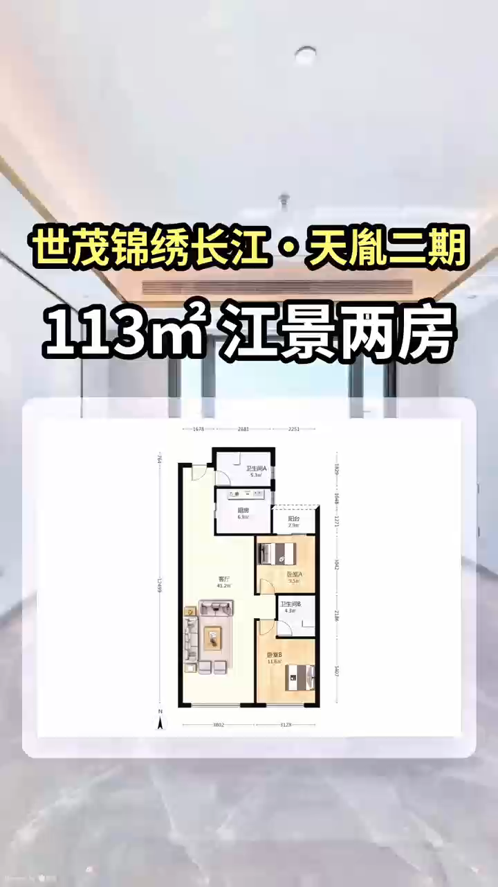
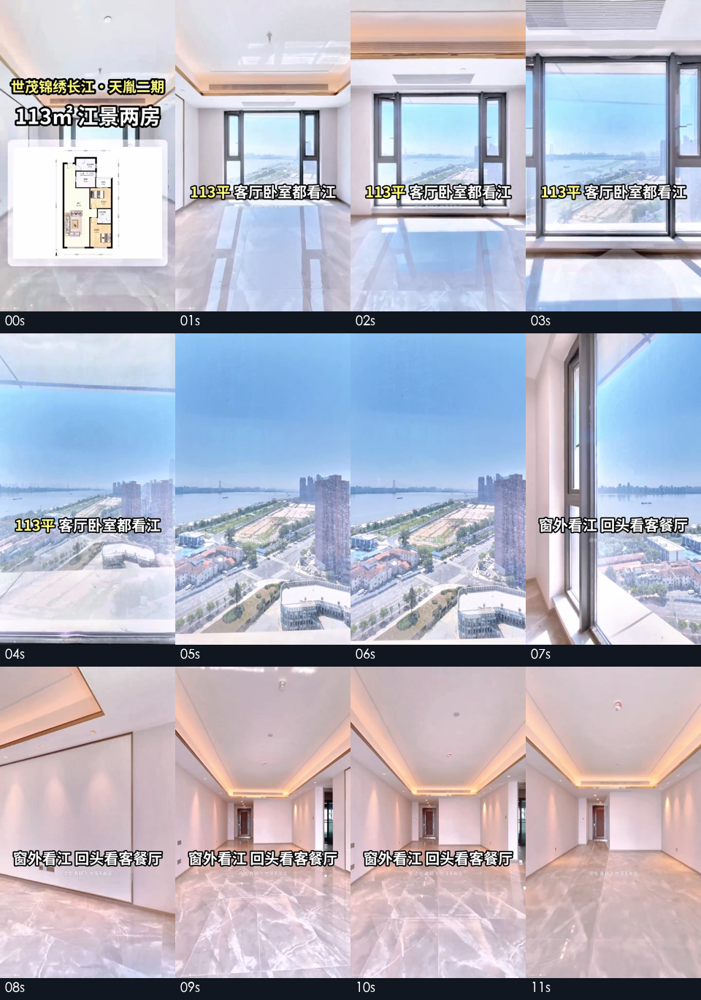
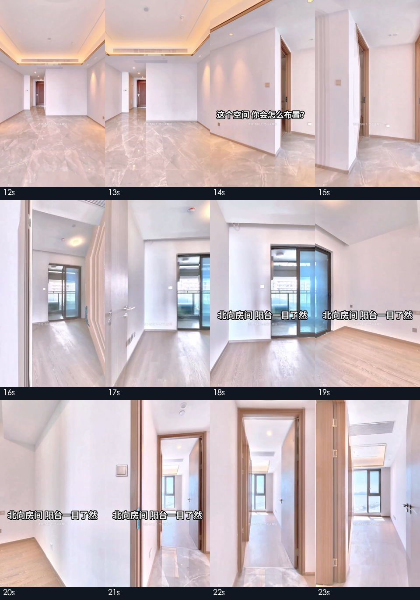
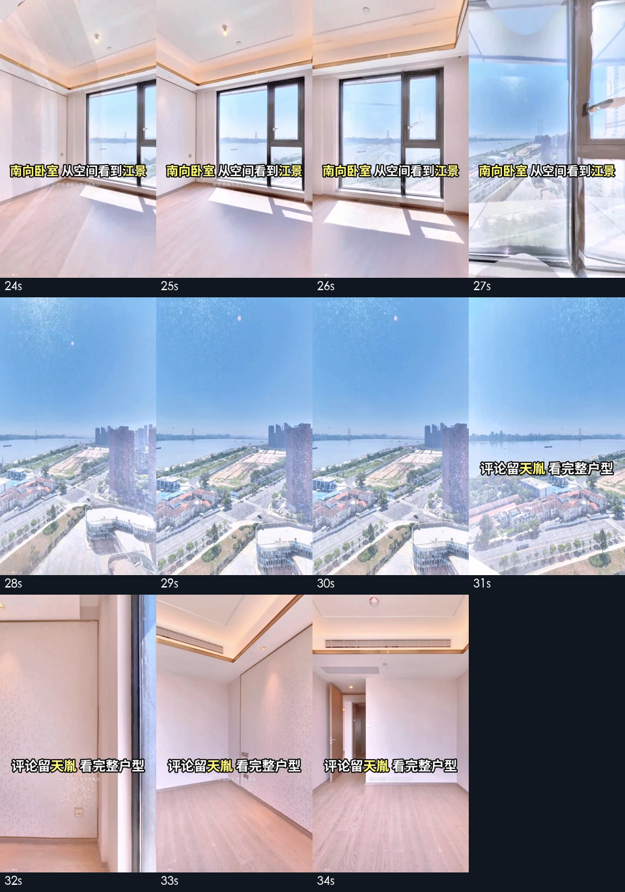
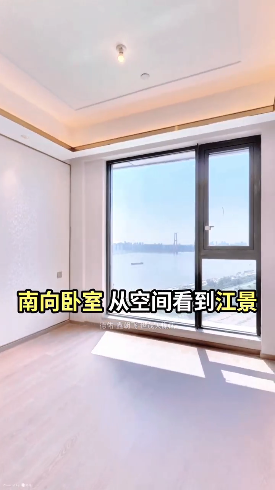
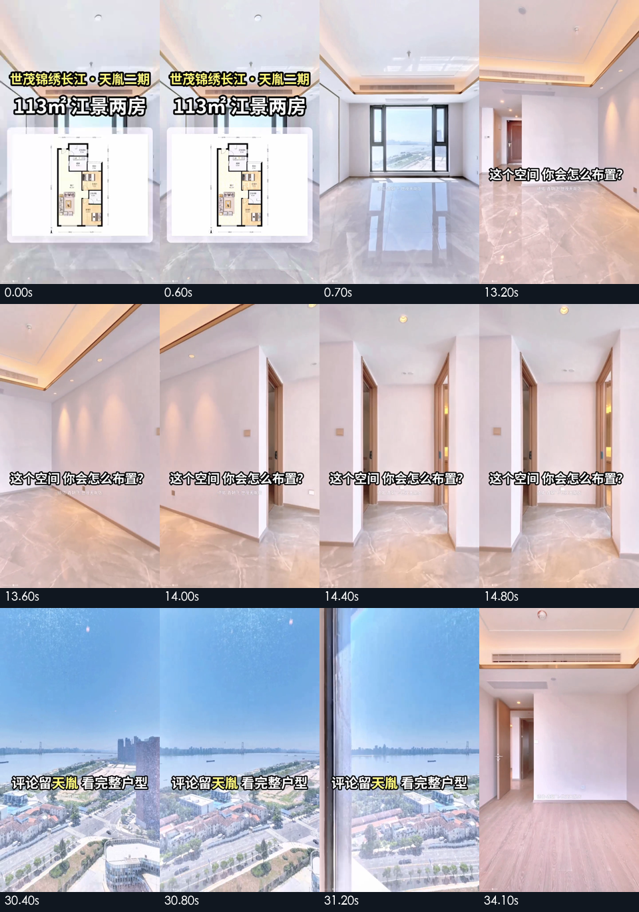

# 参考视频设计思路：先让人记住卖点，再邀请继续看房

> 核心判断：这是一条约34秒的房源宣传短片，不是完整全屋讲解。它把“江景”作为主线，通过客厅与卧室的窗景反复补证，中段邀请观众想象布置，末段引导评论查看完整户型。
>
> 本文件用于后续讨论沙湖九号宣传片的设计方法，不代表已确定新脚本，也不启动新拍摄或剪辑。

## 1. 分析对象与证据边界

| 项目 | 本次记录 |
| --- | --- |
| 原视频 | [d585ed739ce9dafafbb0b31548d47846.mp4](../d585ed739ce9dafafbb0b31548d47846.mp4) |
| 时长、画幅 | 34.166667秒；720×1280，竖屏9:16 |
| 视频、音频 | H.264；元数据平均帧率30fps；AAC、44.1kHz、双声道 |
| 视觉依据 | 0—34秒每秒抽帧，共35张；另核对12张开场、互动及结尾文案边界样本 |
| 观察局限 | 抽帧不是完整逐帧播放验收，不能据此保证每次转场都流畅，或判定完全没有剪切 |
| 声音局限 | 已成功抽出音轨；本地ASR因模型权重未获取而没有转写结果。本次未完成人工听音，不判定口播、男女声、BGM曲风或节拍 |
| 房源事实边界 | “113㎡”“江景”“南向”“北向”等是参考片的屏幕宣传表述，不是本次独立核实的房产信息 |

下文的引号文字均来自**画面文字**，不是已听辨的口播。参考片描述不能直接用于沙湖九号。

## 2. 开场：房源身份、核心卖点、户型地图一起出现

开场信息卡同时回答三个问题：房源是谁、最值得记住什么、整体布局如何。

- 上层是项目名称“世茂锦绣长江·天胤”；下层用更大的字突出“113m²江景两房”。
- 户型图占据画面中下部，背景仍是室内实景，信息卡与后续看房画面保持关联。
- **信息卡实际很短**：0.60秒仍在，0.70秒已消失。它更像身份闪卡，而不是让观众细读尺寸的户型讲解。
- 随后的大字继续强调“113平 客厅卧室都看江”，让主卖点不只依赖开头的短暂曝光。

**可迁移的方法：**用“房源身份＋一个主卖点＋户型轮廓”快速定题。

**不能机械照搬：**约0.67秒的展示不足以读清完整户型。若沙湖九号需要观众理解多房间关系，应另行讨论更长的户型停留，而不是原样复制闪卡时长。

## 3. 时间轴：画面围绕卖点展开，不按房间平均分配时间

以下区间用于理解叙事段落，除开场边界外均为近似范围，不是逐帧字幕起止表。

| 约略时段 | 可见画面与屏幕文字 | 设计作用 |
| --- | --- | --- |
| 0—0.67秒 | 房源信息卡、户型图、室内背景 | 定身份、给地图、提出卖点 |
| 0.67—7秒 | 客厅向窗边推进，随后展示江面与城市景观；前段显示“113平 客厅卧室都看江” | 尽早交付最强视觉证据，不先走冗长过道 |
| 7—13秒 | 从窗边回看客餐厅；7—10秒样本显示“窗外看江 回头看客餐厅” | 将景观与室内尺度联系起来，避免只有窗外风景 |
| 13—15秒 | 客餐厅及通往房间的区域；样本出现“这个空间 你会怎么布置？” | 邀请观众代入生活与布置，而非继续堆参数 |
| 15—23秒 | 进入另一间房，展示房间及阳台方向，再回到门口；18—21秒显示“北向房间 阳台一目了然” | 补充户型另一部分，并保留相邻空间关系 |
| 23—30秒 | 进入另一间卧室，从室内移向窗边和江景；24—27秒显示“南向卧室 从空间看到江景” | 用第二处窗景再次支撑主卖点 |
| 30—34.17秒 | 江景、窗边、回望室内；末段显示“评论留天胤 看完整户型” | 趁卖点印象尚在，把兴趣引向明确的下一步 |

### 3.1 前段证据：先看窗外，再回头看客餐厅

前段不是单独炫耀窗景：7秒开始回望客餐厅，把“能看到什么”与“住在什么空间里”连起来。5—6秒样本没有大字幕，窗景获得了独立展示的机会。

### 3.2 中段证据：互动提问后，用另一间房补充布局

中段没有连续覆盖所有辅助空间，而是选择一个房间和阳台方向补充认识。进入、回看与退出的画面，有助于观众把房间与走道联系起来。

### 3.3 后段证据：第二处窗景重复主张，再接行动引导

卧室也展示江景，使前段主张得到第二个画面支撑。结尾不是单纯“感谢观看”，而是“评论关键词＋获得完整户型”的具体动作。

## 4. 运镜思路：先建立空间，再接近重点，再回望关系

从抽帧可见的运动顺序，可归纳为三个反复使用的动作：

1. **先看室内全貌。**给窗、墙面、门口和地面同时留位置，让观众知道自己站在哪里。
2. **再接近窗口或阳台方向。**让卖点从室内的一部分，变成画面主体。
3. **随后回望或退回门口。**补充房间尺度与连接关系，不让观众只记得窗外。

这比“一个房间拍一张正面图，再切到下一个房间”更有带看感。文字“回头看客餐厅”“从空间看到江景”也在解释镜头意图。

### 4.1 运镜与字幕一起证明同一个卖点

这张画面同时给出室内范围与窗外景观，文案指向观众此刻可以检查的东西。可学的是**一句主张对应一处可见证据**，不是靠形容词替代画面。

局限也要保留：窗口推进样本可见叠影、融合痕迹。它不适合被当作完全无变形的实拍运镜范本；仅凭这些样本，也不能还原作者具体使用的采集、录制与剪辑工具。

## 5. 字幕思路：大字少句，关键词上色，给画面留空

- **一屏一个意思。**常见句式是“区域／方向＋看点”，不是连续塞入楼层、价格、面积、装修、交通等多项信息。
- **白色粗字配黑描边。**在亮窗、白墙与地面之间移动时，文字仍有较好的可辨性。
- **黄色只强调少量词。**例如“113平”“南向卧室”“江景”和评论关键词“天胤”，帮助快速抓重点。
- **主字幕位于画面中下部，约画面高度六成附近。**不是最底部的小号口播字幕；模仿时须避免压住要展示的门口、柜体或窗景。
- **有无大字幕的交替。**窗景和空间展示中存在留白段，说明文字不是始终覆盖画面的必要条件。
- **来源信息另用小字。**可见经纪门店署名和底部平台标识；具体权属、转载许可并未核实，不能理解为允许借用原片。

### 5.1 文案边界核对：互动问句与结尾CTA确实存在

补充样本确认：信息卡在0.60秒仍显示、0.70秒消失；13.2—14.8秒样本可见布置问句；30.4秒以后样本出现评论引导。34.10秒样本已没有大字，结尾字幕不是覆盖到最后一帧。

**设计风险：**互动问句停留较短，复杂问题不适合这样呈现；竖屏大字也可能遮挡空间。借鉴结构时应重新检查可读时间和遮挡情况，不直接套用像素大小与字幕时长。

## 6. 销售表达：一个主卖点，两处补证，两次邀请

参考片的可迁移骨架是：

**身份与户型 → 主卖点画面 → 回看室内 → 布置提问 → 另一房间补证 → 评论查看完整户型。**

这条骨架有三个值得讨论的特点：

1. **重复卖点，而不平均介绍。**客厅和卧室都服务于“江景”主题；重复的是证据，不是同一句夸赞。
2. **先让人想住，再邀请继续了解。**中段的布置问句是轻互动；末段查看完整户型是具体下一步。两者承担不同任务。
3. **短片与完整带看分工。**短片负责让人记住房源、产生兴趣；完整户型或带看负责解答细节。不是把完整带看所有房间匀速压进几十秒。

这些是设计意图的解读，不是已验证的营销效果。本次没有观看完成率、评论率或咨询转化数据，不能断言这种结构一定带来更多成交。

## 7. 迁移到沙湖九号：学表达机制，不借用参考房源事实

| 可以讨论借鉴 | 不应直接照搬 |
| --- | --- |
| 用一个核实过的主卖点组织短片 | 把“113㎡、两房、江景、南北朝向”套到沙湖九号 |
| 先交付代表性画面，再补充空间关系 | 为复制参考节奏而擅自加速、跳剪既有全屋作品 |
| 一句文案对应一处可见证据 | 未核实的采光、尺度、装修或生活价值承诺 |
| 关键字强调、适当留白 | 原片署名、品牌标识、画面或户型图未经许可直接复用 |
| 轻互动与明确下一步分开设计 | 复制“天胤”评论词，或承诺提供尚未准备好的材料 |
| 宣传短片与完整带看分别承担任务 | 用宣传短片替代完整全屋覆盖及原路线验收 |

沙湖九号已有全屋工程应继续独立保留，不覆盖旧精选漫游或全屋成片。既定全屋要求中的亲切女声、无BGM、路线与时间保持不因本次参考分析自动改变。

多房间、阳台与其他空间可以成为候选展示内容，但**哪些内容应成为主卖点、如何表述、如何用画面证明，仍需核对并讨论**。本文件不预先指定“江景豪宅”“南北通透”等标签。

声音设计也不能从当前视觉证据推导：参考片是否有口播、音乐及其节奏尚未核实。新宣传片是否沿用女声无BGM，应作为独立决策，而不是声称在模仿已听清的参考音轨。

## 8. 下一轮讨论只需先确定五件事

1. **宣传片的第一记忆点是什么？**选一个有核实依据且能用画面展示的核心理由。
2. **哪些镜头足以证明它？**挑选代表性空间和视角，而非默认全空间平均介绍。
3. **与全屋带看如何分工？**宣传片要提供哪些信息，剩余哪些问题交给完整带看。
4. **观众下一步做什么？**看完整带看、预约看房或获取资料；只承诺实际能交付的内容。
5. **声音与运动约束如何沿用？**确定是否保持女声无BGM，以及独立宣传片的路线、时长和剪辑边界，再开始制作。

**最终提炼：**参考片最值得学的，不是黄色大字或江景画面本身，而是“先提出一个清楚的理由，再让镜头反复证明，最后给观众一个明确下一步”。

## 9. 证据与复核说明

- [参考视频信息.json](参考视频信息.json)：ffprobe元数据、原视频SHA-256及分析范围。
- [提取证据.py](提取证据.py)：抽帧与可选本地ASR的实现；本次文档中的PNG是已生成并目视核对的证据。已有证据PNG时脚本拒绝静默重导；仅查音轨可使用`--audio-only`。
- 原视频SHA-256：`dd894a5f2847f1c6e71951e21522bd5dd5191aafba9aea5e962909a0c95345dd`。
- [参考音轨.wav](参考音轨.wav)：为本地ASR抽取的16kHz单声道音轨；声音细节复核宜优先播放原视频。
- 声音检查止于音轨存在和成功提取；模型权重未获取，未生成`音轨自动转写.json`。没有转写结果不等于没有人声。
- 本次分析未修改原始MP4；未对沙湖九号进行新拍摄、剪辑、重配音或目录迁移。
